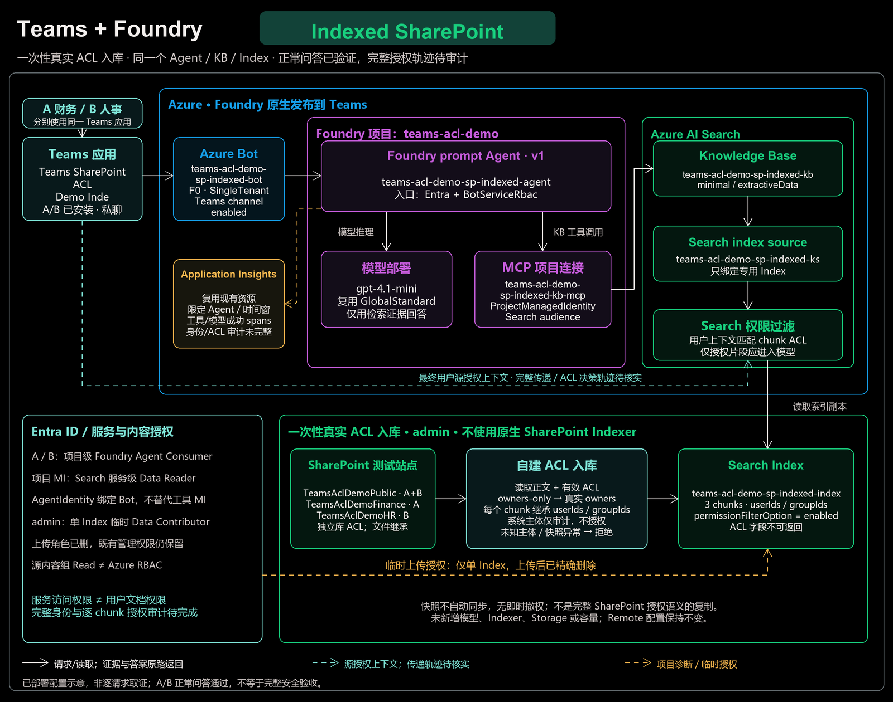
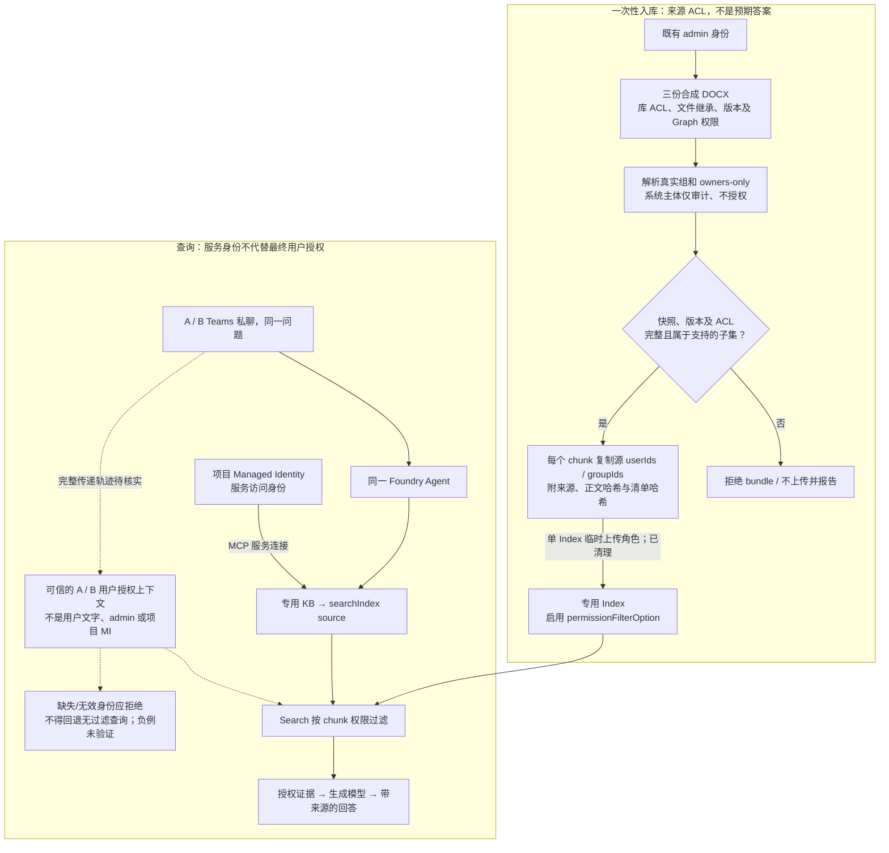
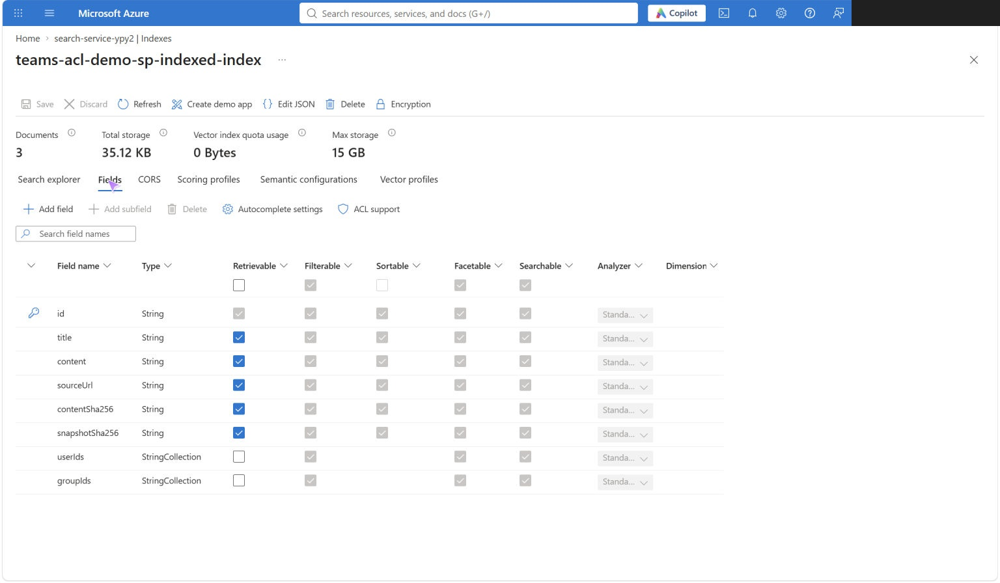
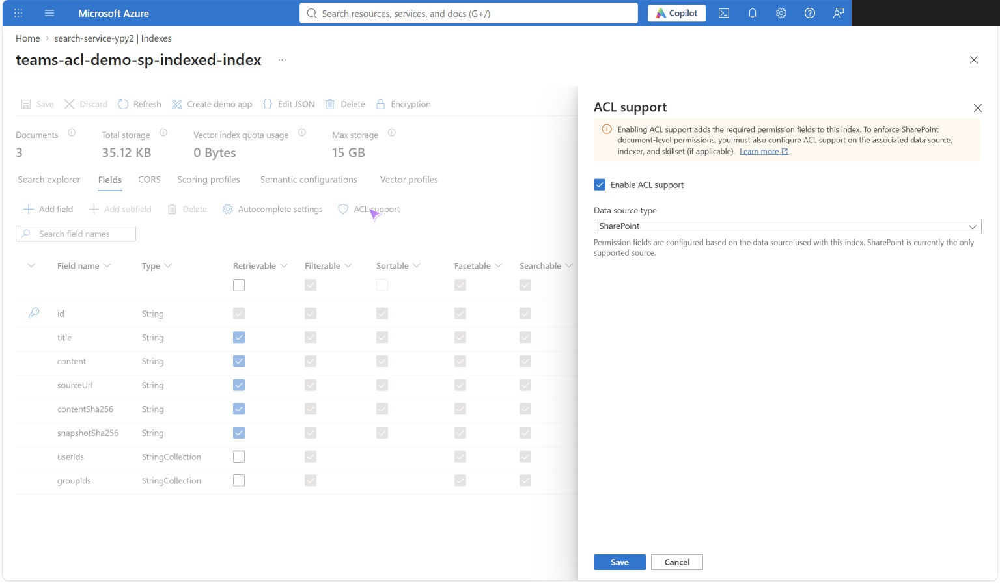
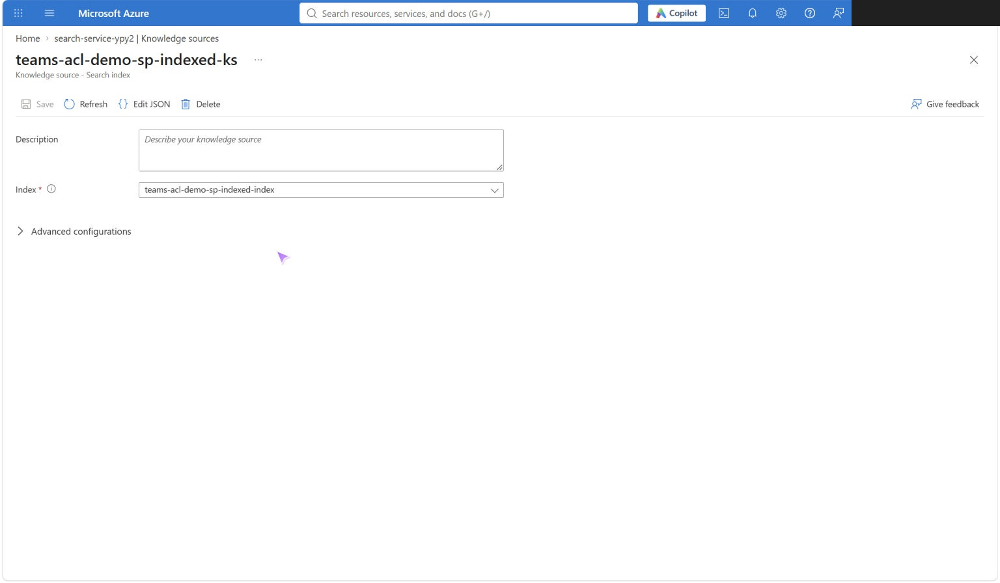
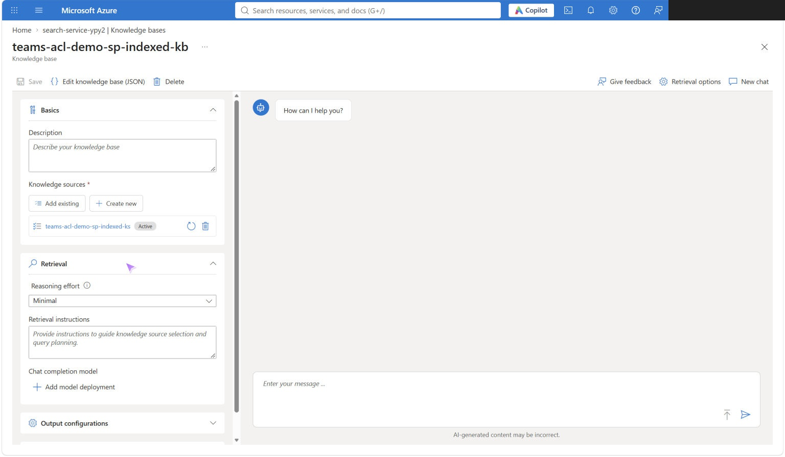
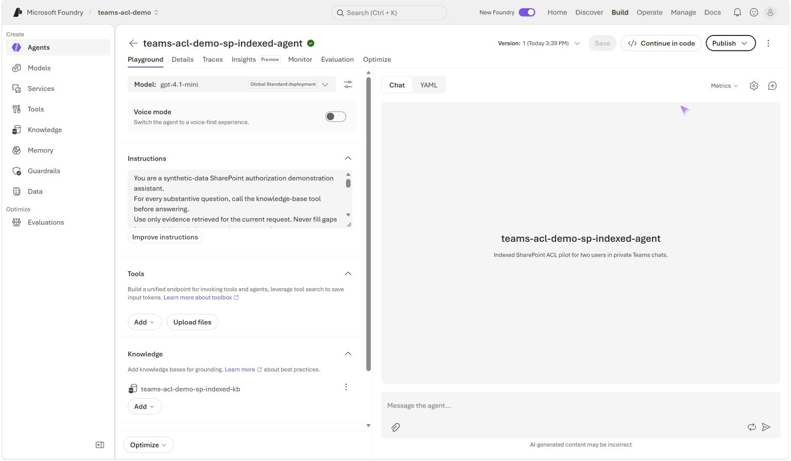
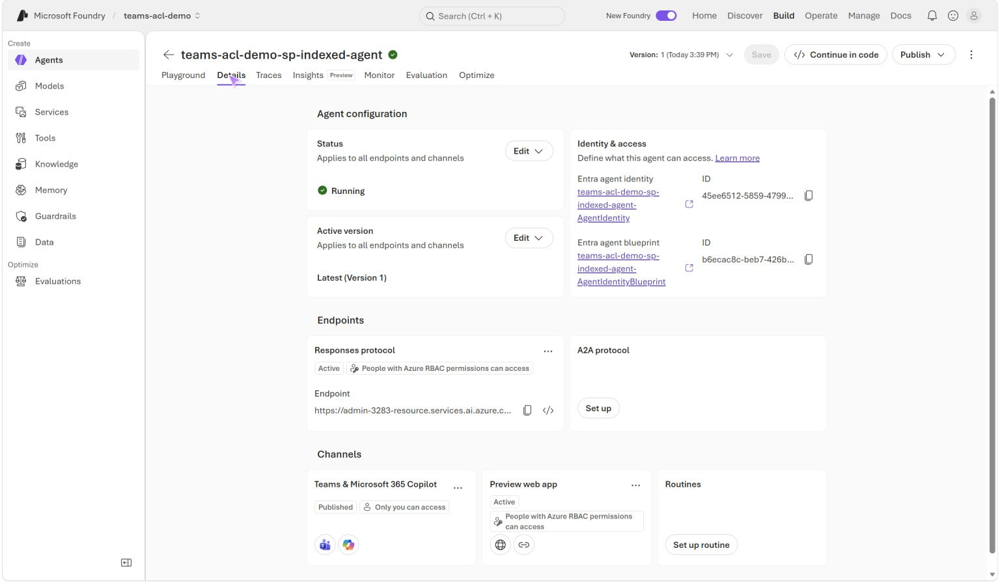
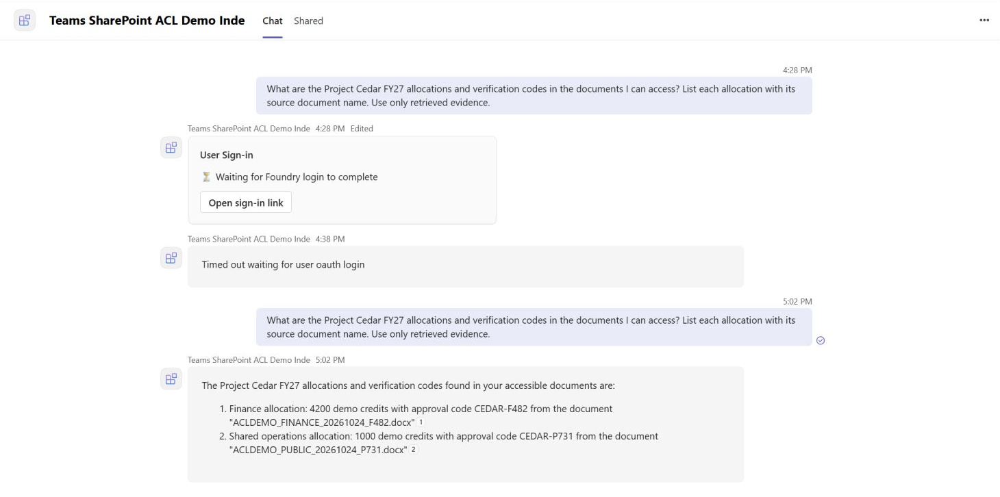
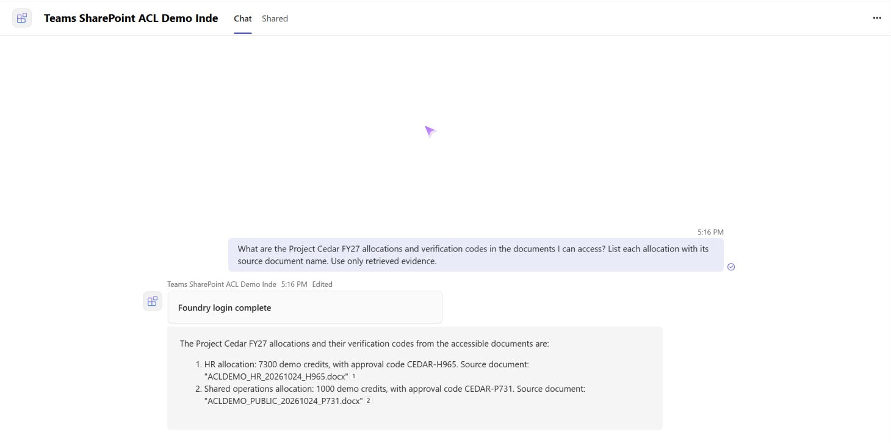

# Teams + Foundry + SharePoint：Indexed Demo 操作与测试说明

## 1. 背景与需求

两个权限不同的 Entra 用户，在 Teams 中向**同一个 Agent、同一个 KB、同一个 Index**提同一道问题，只能得到自己有权读取的 SharePoint 内容。权限必须来自真实 ACL，在内容进入生成模型前执行，不能硬编码用户部门或靠提示词隐藏答案；隔离范围包括正文、标题、金额、校验码和链接。

当前租户启用了 Conditional Access（CA），不在原生 SharePoint Indexer 的官方支持范围内，因此采用 **真实内容与 ACL 一次性采集 → 自建分块 Push 入库 → `searchIndex` knowledge source**。这不是原生 `indexedSharePoint` 连接器，不关闭 CA、不扩大源权限，也不修改 [Remote 路线](README.md)。

> **已完成：** 2026-10-25 入库 3 个受保护 chunk，临时上传角色已清理；独立 Agent 已 Shared 发布，真实 A/B 私聊分别返回 Public + Finance、Public + HR，金额、校验码和文件名符合预期。**答案级验证通过，不等于完整身份/ACL 审计通过或生产就绪。** 身份与角色最近只读核对时间为 2026-10-26 13:39（UTC+8）。

仅使用 test 站点的三份合成文档，各文件继承所在库的独立权限；对应内容组 Read，Owners 保留 Full Control。

| 专用文档库 | 文件 | 内容 | 内容组 / 测试用户 |
| --- | --- | --- | --- |
| `TeamsAclDemoPublic` | `ACLDEMO_PUBLIC_20261024_P731.docx` | 1000 demo credits / `CEDAR-P731` | `sg-teams-acl-demo-public` / A+B |
| `TeamsAclDemoFinance` | `ACLDEMO_FINANCE_20261024_F482.docx` | 4200 demo credits / `CEDAR-F482` | `sg-teams-acl-demo-finance` / A |
| `TeamsAclDemoHR` | `ACLDEMO_HR_20261024_H965.docx` | 7300 demo credits / `CEDAR-H965` | `sg-teams-acl-demo-hr` / B |

上述用户归属是验收预期，**不是入库 ACL 的生成规则**。已有环境无需重建；直接查看[配置截图](#43-portal-配置核对与截图)和[实际测试结果](#5-实际测试结果)。

## 2. 实际身份、角色与作用域

### 2.1 作用域

身份表中的 scope 简称按下列路径展开：

| 简称 | 实际 ARM scope |
| --- | --- |
| SUB | `/subscriptions/3456866f-6478-471f-8d59-a29a335d797a` |
| MG | `/providers/Microsoft.Management/managementGroups/72c10632-ee48-4c08-a16a-e6cea1dbb7ef` |
| FOUNDRY-RG | SUB + `/resourceGroups/rg-admin-3283` |
| PROJECT | FOUNDRY-RG + `/providers/Microsoft.CognitiveServices/accounts/admin-3283-resource/projects/teams-acl-demo` |
| SEARCH | SUB + `/resourceGroups/aks-test/providers/Microsoft.Search/searchServices/search-service-ypy2` |
| INDEX | SEARCH + `/indexes/teams-acl-demo-sp-indexed-index` |

### 2.2 身份与绑定

2026-10-26 只读核对了项目、专用连接、Agent、Bot、Graph 身份及上述资源上的直接角色分配和继承 scope，没有改权限。

| 身份 / 标识 | 用途 | 实际角色或绑定 / scope |
| --- | --- | --- |
| admin：`admin@MngEnvMCAP566860.onmicrosoft.com`；OID `46832239-f08b-4172-96a2-59fd65cf193a` | 采集源内容/ACL、部署和一次性上传，不代替 A/B 查询 | 既有 `Search Service Contributor`、`Search Index Data Reader`，均直接绑定 SEARCH |
| admin 的既有上级角色 | 说明当前管理能力，不是 demo 最小权限建议 | `Owner`：SUB、MG；`User Access Administrator`：MG；`Foundry User`：SUB、FOUNDRY-RG；`Container Apps SandboxGroup Data Owner`：SUB，未将其作为本路线必需角色 |
| admin 的临时上传角色 | 仅首次 Push 上传 | `Search Index Data Contributor`，**仅 INDEX**；assignment 末段 `78c7d66b-6322-49b2-8bc8-2df4b2f5f472` 已删除，2026-10-26 精确 GET 再次确认不存在 |
| 项目 System-assigned MI：`9b0e1ace-4ecc-452f-b7fc-a79adea38851` | KB/MCP 的 Search 服务访问身份 | 既有 `Search Index Data Reader`，**SEARCH 服务级，不是仅 INDEX**；不等于 A/B 的文档授权 |
| A：`gaussye@MngEnvMCAP566860.onmicrosoft.com`；OID `cb1985cb-b3aa-49ee-8601-a159e2f6406f` | Teams 最终用户 | 既有 `Foundry Agent Consumer`，直接绑定 **PROJECT**，不是单个 Agent 或订阅 |
| B：`pengyongye@MngEnvMCAP566860.onmicrosoft.com`；OID `373e6941-bcf1-4392-889f-a69611797bc1` | Teams 最终用户 | 同上 `Foundry Agent Consumer`，直接绑定 **PROJECT**；不授予全部 SharePoint 文档 |
| AgentIdentity：client/principal ID 均为 `45ee6512-5859-4799-97c7-b3523bec526b` | Indexed Agent 运行/发布身份；Graph 类型 `agentIdentity` / `ServiceIdentity` | 查询的 PROJECT、SEARCH、INDEX 及继承列表中未观察到该 principal 的直接适用分配；**不是工具连接使用的项目 MI** |
| Agent blueprint：client ID `b6ecac8c-beb7-426b-8966-534b765a2cf4`；principal ID `66d2940a-1f52-4d0b-9c0c-fb22cc62bcc6` | Agent version 的身份蓝图引用 | 不是 RBAC 角色名；未审计其全部权限 |
| Bot：`teams-acl-demo-sp-indexed-bot` | Teams 通道应用绑定 | `msaAppId` 与 AgentIdentity client ID 相同；`SingleTenant`，tenant `72c10632-ee48-4c08-a16a-e6cea1dbb7ef`，`msaAppMSIResourceId: null`；不是 Search RBAC 分配 |

相关角色定义 ID：Data Contributor 为 `8ebe5a00-799e-43f5-93ac-243d3dce84a7`，Data Reader 为 `1407120a-92aa-4202-b7e9-c0e197c71c8f`，Agent Consumer 为 `eed3b665-ab3a-47b6-8f48-c9382fb1dad6`。

**工具连接实际使用项目 MI。** `teams-acl-demo-sp-indexed-kb-mcp` 读回为 `authType: ProjectManagedIdentity`、`category: RemoteTool`、`audience: https://search.azure.com/`、`isSharedToAll: false`，仅指向本路线 KB 的 `/mcp`；Agent v1 引用此连接，仅允许 `knowledge_base_retrieve`。Bot/AgentIdentity 绑定一致不代表工具也用该身份。最终用户授权上下文的完整传递仍待服务端轨迹验证。

### 2.3 源文档授权：不是 Azure RBAC

2026-10-25 采集时，三个库有独立权限、文件继承库 ACL；内容组均解析为真实 Entra 安全组：

| 内容组 | 写入 chunk 的 `groupIds` |
| --- | --- |
| `sg-teams-acl-demo-public` | `899881ee-bf57-484b-9dde-7306f1cfe3f5` |
| `sg-teams-acl-demo-finance` | `e22982f5-cd5d-457f-a313-8495825a6103` |
| `sg-teams-acl-demo-hr` | `534ff5e2-de44-44bd-803b-787f1b3a3bf1` |

内部 Owners 组包含 `SHAREPOINT\system` 和 M365 owners-only claim。后者仅展开 Graph 返回的真实 owners，本次只有 admin，写入 `userIds`，**不把 owners-only 的组 GUID 当成全组授权**。仅精确系统主体不生成 Entra 查询授权并保留审计；其他未知主体拒绝入库。admin 当时的 `IsSiteAdmin: true` 是 SharePoint 状态，不是 Azure RBAC 角色。

**核对边界：** 源 ACL 是采集时快照，不是实时组成员检查。本次 RBAC 读回未遍历所有组、PIM、deny assignments、其他 scope、Graph/Entra 间接授权或自定义角色操作。临时 assignment 已删除，但 admin 仍保留上述管理权限，不能说“已无任何写入或重新授权能力”。

## 3. 系统架构与权限流程



[动态图](docs/images/indexed/indexed-system-architecture.gif) · [可编辑 Excalidraw 源文件](docs/images/indexed/indexed-system-architecture.excalidraw)

按已部署组件绘制；动画高亮仅说明调用与入库方向，不是实时遥测。青色虚线表示最终用户授权上下文，完整传递轨迹尚未核实；项目 MI 只承担工具的服务访问。

<details>
<summary>权限流程细节（Mermaid）</summary>

实线表示已实现的入库/已部署问答路径；**虚线表示尚未完成服务端身份轨迹或对应负例验证的授权边界**。Search 应在正文进入模型前执行权限过滤，不能由模型决定授权。



</details>

**这是一次性快照 POC，不是同步连接器。** 查询不会重新读取 SharePoint ACL；源权限变化不会自动更新 Index，不提供即时撤权、跨服务原子快照或完整 SharePoint 授权语义。

## 4. 正常流程操作手册

### 4.1 实际部署的组件

| 组件 | 实际配置 |
| --- | --- |
| Search | `search-service-ypy2`，资源组 `aks-test`，Basic / West US / 1 replica / 1 partition，未扩容 |
| Index | `teams-acl-demo-sp-indexed-index`，3 个 chunk，纯文本及 `acl-semantic`，无新增 embedding 模型 |
| Knowledge source | `teams-acl-demo-sp-indexed-ks`，`kind: searchIndex`，只绑定上述 Index |
| KB | `teams-acl-demo-sp-indexed-kb`，只引用上述 KS，minimal / `extractiveData`，`models: []` |
| Foundry | 复用 `admin-3283-resource` / project `teams-acl-demo`；独立 `teams-acl-demo-sp-indexed-agent` v1，现有 `gpt-4.1-mini` GlobalStandard / `2025-04-14` |
| MCP 连接 | `teams-acl-demo-sp-indexed-kb-mcp`；项目 MI，Search audience |
| Teams 入口 | `teams-acl-demo-sp-indexed-bot`，F0 / SingleTenant，`MsTeamsChannel` enabled；显示名 `Teams SharePoint ACL Demo Inde` |
| 发布标识 | app ID `ecf2c1c7-cc30-405d-9a5d-dc8a8f49b19e`；原生 title ID `T_62ff21ea-69c2-000b-d799-8f073ccaa3eb` |

Search API 为 `2026-08-01-preview`。专用工具端点：

```text
https://search-service-ypy2.search.windows.net/knowledgebases/teams-acl-demo-sp-indexed-kb/mcp?api-version=2026-08-01-preview
```

发布范围是 **Shared**，不是组织商店审批通过；endpoint 含 `Entra`、`BotServiceRbac`、`activity`，没有 `BotServiceTenant`，`publish_approval_status: not_published`。A/B 已经由原生 titleId 入口分别安装并成功问答，不能把它等同于组织商店可搜索。

### 4.2 搭建顺序与前置条件

以下是已完成的搭建顺序，**不是重跑部署或扩大授权的指令**：

1. 核对既有 admin、租户、订阅及 Remote 基线，检查专用 Index/KS/KB/Agent 名称碰撞。复用现有 Search、项目、模型和身份，不新增凭证、权限同意、CA 排除、组成员或容量变更。
2. 从获批站点一次性读取三份 DOCX，以及 SharePoint 库 ACL、文件继承、内部组/站点管理员和 Graph 权限/owners。前后核对版本与 ACL；机器快照不能用人工摘要或测试 fixture 替代。
3. 本地校验、提取纯文本、分块，每个 chunk 复制源 ACL、来源和审计哈希。未知主体/角色、未支持的权限形态或不完整快照失败关闭，见第 7 节。
4. 条件创建独立 Index → KS → KB，读回 schema；仅给 admin 在 INDEX 新增临时 Data Contributor，Push 上传，在 `finally` 中删除本次精确 assignment，再独立核实不存在。不取 admin key，不扩大到服务级上传角色。
5. 单独获批后创建专用 MCP 连接、Agent、Bot、Teams channel，并原生 Shared 发布；读回目标/身份/范围，核对 Remote Agent 完整 GET 前后相等。
6. A/B 分别核对真实身份、获批安装后个人私聊测试；预算、实测和限制见第 5–6 节。未创建线上评估套件。

### 4.3 Portal 配置核对与截图

以下 6 图拍于 **2026-10-25 17:27–17:32（UTC+8）**。资源由脚本/API 创建，图为**部署后的实际配置页，不是历史创建向导**。已裁除浏览器栏、遮挡 Portal 账号；补图未保存配置、重建、发布或发送测试消息。

#### 1. Index 字段

[Azure Portal](https://portal.azure.com/) → `aks-test` → `search-service-ypy2` → **Search management → Indexes** → `teams-acl-demo-sp-indexed-index` → **Fields**。Documents 为 **3**；正文、来源、审计哈希及 `userIds` / `groupIds` 均在，后两者为 StringCollection，Retrievable 关闭。



#### 2. Index 权限过滤

同页 → **ACL support**，查看后 **Cancel**。Enable ACL support 已勾选。API 读回确认 `permissionFilterOption: enabled`，`userIds` / `groupIds` 有对应 `permissionFilter`，均 `filterable: true`、`retrievable: false`，语义配置 `acl-semantic`。



面板的 SharePoint 标签及 indexer 提示**不代表用了原生 SharePoint Indexer**；完整 schema 以 API 读回为准，不能从灰色复选框推断全部属性。

#### 3. Knowledge source

Search → **Agentic retrieval → Knowledge sources** → `teams-acl-demo-sp-indexed-ks`。类型为 **Search index**，目标只绑定专用 Index，不是 `indexedSharePoint` 或 Remote source。



#### 4. Knowledge base

Search → **Agentic retrieval → Knowledge bases** → `teams-acl-demo-sp-indexed-kb` → 展开 **Retrieval**。单一 KS 为 Active，Reasoning effort 为 Minimal，没有添加聊天模型。API 另确认 `models: []`、`extractiveData`；后者在截图中未展开，生成答案使用后续 Agent 的模型。



#### 5. Agent 配置

[Microsoft Foundry](https://ai.azure.com/) → project `teams-acl-demo` → **Build → Agents** → `teams-acl-demo-sp-indexed-agent` → **Playground**。显示 v1、`gpt-4.1-mini` Global Standard，Knowledge 挂载专用 KB；指令要求先检索、仅用当前证据，失败不编造或自动重试。指令不是授权机制，连接身份以第 2 节读回为准。



#### 6. Agent 与发布状态

同一 Agent → **Details**：Running、Latest (Version 1)、独立 identity/blueprint，Teams & Microsoft 365 Copilot 为 Published。页面同时显示 **Only you can access**；保留原标签，不据此否定已实测的 A/B 访问，也不据 Published 宣称组织审批通过。



### 4.4 在 Teams 复现正常问答

**现有问题预算已用满 3/3，以下仅供后续获批测试使用，不自动补发或重试。**

1. 用两个隔离浏览器会话分别打开 A/B Teams，从账号菜单核对完整测试账号，不以浏览器 profile 名称代替身份；不要操作公司、admin 或 Remote 聊天。
2. 从本应用的原生 **titleId** 入口打开 `Teams SharePoint ACL Demo Inde` 个人聊天；普通 appId 链接和组织商店列表不是已验证入口。A/B 已安装，不需要重复 Add、重建 Agent 或扩大发布范围。
3. 两人使用同一道问题，不夹带预期金额、校验码或未授权文件名：

```text
What are the Project Cedar FY27 allocations and verification codes in the documents I can access? List each allocation with its source document name. Use only retrieved evidence.
```

4. 仅出现 Foundry 登录卡时，由该用户完成对应认证，等待 **Foundry login complete**；不切 admin、不导出令牌、不重复提问。遇密码/MFA、新同意或现有 SSO 不可用时停止自动操作，由用户处理。
5. 等实际答案，核对金额、代码、文件名和引用，不能把 Sent、等待登录或占位消息当成功。正常测试只在 A/B 私聊进行；引用链接逐一打开、其他聊天范围保护尚未验收。

## 5. 实际测试结果

测试日期 **2026-10-25**，下表时间为 **UTC+8**；不是 Remote 结果或根据预期填写的记录。

| 检查 | 实际结果 | 结论 / 边界 |
| --- | --- | --- |
| 真实采集与入库，14:17–14:30 | 三份 DOCX 共 **53,167 bytes**，3 个上传 action 均 `status: true, statusCode: 201`，独立 stats 为 `documentCount: 3` | 来源/ACL/版本有原始归档；非本地 mock |
| 部署只读复验，15:08:59 | schema、权限字段、KS/KB 单源绑定及容量符合预期；精确临时 assignment 不存在 | 证明配置与清理，不证明 A/B 查询授权轨迹 |
| A 首轮，16:28 → 16:38 | 收到登录卡，随后 OAuth 超时 | 失败，计入消息预算 |
| A 同题，17:02 | Finance **4200 / CEDAR-F482** + Public **1000 / CEDAR-P731**；DOCX 名称正确，未观察到 HR 内容/文件名/链接 | 答案级通过；该条问题非本助手发送，来源未核实，仍计入预算 |
| B 同题，17:16 → 17:17 | Foundry login complete；HR **7300 / CEDAR-H965** + Public **1000 / CEDAR-P731**；DOCX 名称正确，未观察到 Finance 内容/文件名/链接 | 已核实 B demo 身份，答案级通过 |
| 既有 Application Insights | 17:02 和 17:17 各有成功的 `invoke_agent`、`mcp_knowledge-base.knowledge_base_retrieve`、`chat`，共 **6 spans** | 支持真实工具/模型执行；不是完整调用/计费次数，也不证明调用者 OID 或逐 chunk ACL 决策 |
| 本地回归 | **23 个 Python 测试方法、53 项 Node 测试通过** | 覆盖解析、失败关闭、部署/恢复、角色清理和配置复验；不代替云端负例测试 |

**预算：** 观察到 A 两条、B 一条，共 **3/3**；助手发送 A/B 各一条，无自动重试。早先独立 KB-only 测试因缺少 A/B 合法委托身份停在前置检查，实际 **0/2**，不能把它当成额外 Teams 额度。两路线预算不共用。

### A/B 真实回答截图

两图补拍于 **2026-10-25 17:42（UTC+8）**，仅查看已有对话，未重登或发消息；已裁掉浏览器、账号与输入框。归属依据此前核实的真实身份和消息 ID，不由答案内容反推。

**A：Public + Finance。** 保留首轮超时与后续成功，成功回答 ID `1792918929989`，对应问题 ID `1792918927998`。



**B：Public + HR。** 问题 ID `1792919813415`，回答 ID `1792919848263`；保留登录完成状态。



## 6. 遇到的问题与演示边界

| 问题 | 处理与当前结论 |
| --- | --- |
| CA 租户不在原生 Indexer 支持范围 | 保留 4 条 enabled CA 策略，改用获批自建 Push；private 网络设置或改用应用身份不代表消除该限制。未创建或运行原生 Indexer，不能说原生路线已成功或实际报了 401/403。见 [Indexer 限制][1]、[原生 source 前提][2] |
| 委托登录能读正文，不代表内置 ACL 摄取成立 | 内置 ACL 摄取要求 application permissions；自建快照另行校验真实 ACL。没有新增应用权限、federated credential 或 `Files.Read.All` / `Sites.FullControl.All`；`Sites.Selected` 同意不等于站点授权，路径过滤也不是凭证权限边界。[3] |
| Owners 组被误认为空组 / Graph `inheritedFrom` 为空 | 交叉读取 SPO 库角色、文件继承、内部组及 Graph owners，不能丢掉 Owners 或把 owners-only 扩成全组；CLI SPO 返回 Unauthorized 时未反复 logout/login，改用既有正规浏览器会话 |
| 连接创建后 `isSharedToAll` 读回 false | 首次停止留证；仅 Indexed 配置采用更窄的 false，核验后复用唯一已建连接继续，未改 Remote 构造器。恢复不是通用覆盖/重试开关 |
| 发布成功但普通入口不可用 | 使用实际发布返回的原生 titleId；Shared、组织商店可搜索、A/B 安装是不同状态，未扩大租户发布范围。Graph catalog 查询 Forbidden 时未新增 scope/同意 |
| A 登录超时 | 保留失败与后续已有成功记录；不点击过期卡或为截图重发。B 使用已批准的既有 demo SSO 完成，不混用其他账号 |

尚未完成的验证集中在以下边界，不以正常正例替代：

| 待验证项 | 当前状态 |
| --- | --- |
| 最终用户授权上下文、Search query-source authorization、逐 chunk ACL 决策 | 未完成完整服务端轨迹核实；项目 MI 的 Reader 角色不是用户文档授权证明 |
| 缺失/过期身份、无 app-only 或无过滤 fallback | 未测试 |
| 历史会话归属、真正并发、线上强制私聊保护 | 未测试；目前仅做合成数据 A/B 私聊演示，不在群聊/频道公开内容 |
| 来源引用链接逐一打开 | 未验收；已核对答案文件名，不承诺所有通道的引用支持 |
| 撤权传播 | 按用户要求延期；Push 方案需更新受影响 chunk，原生 Indexer 的父级 ACL 变化也需显式 resync/resetdocs。[3] 旧聊天答案不会随源撤权自动消失 |

Search 复用固定容量，不新增 Indexer、Storage、计算服务或 embedding 部署，**不代表链路免费**。生成模型、检索和日志可能分别计量；未形成完整运行费用估算。后续调用、同步、凭证/权限或发布变更需另批。本次仅整理文档，没有新增云调用或测试消息。

## 7. 本地工具与复验

### 7.1 工具分工与重跑限制

| 脚本 | 用途 / 约束 |
| --- | --- |
| `scripts/indexed-browser-capture.mjs` | 既有 admin 同源 GET-only 采集；核对函数指纹/身份，归档原始快照、下载回执及三份 DOCX，不导出 cookie/token |
| `scripts/indexed_capture_import.py` | 用同一管理身份解析 Graph ACL/owners，导入本地归档，拒绝覆盖目录 |
| `scripts/indexed_acl.py` | Python 标准库离线校验、纯文本提取、分块及 bundle 准备；不认证、下载或上传 |
| `scripts/indexed_deploy.py` | 仅首次创建 Index/KS/KB、临时角色、上传与精确清理；固定获批目标，`If-None-Match: *`，同名即停止，不是更新器或自动回滚器 |
| `scripts/indexed_agent_deploy.py` / `indexed-agent-config.mjs` | 专用连接/Agent/Bot/Shared 发布；`--resume-connection-evidence` 仅接受历史连接单对象校验失败，拒绝 Agent 已创建或其他失败状态 |
| `scripts/indexed_verify.py` | GET-only 检查 schema、计数、容量及临时角色清理，不查询正文或验证 A/B 权限 |

**不要重跑已成功的采集/部署，也不要修改快照时间绕过 15 分钟校验。** 所有输出须使用未存在的路径；含源正文和实际环境证据的 `.azure/` 被 Git 忽略，不提交令牌、凭证或登录缓存。

仅运行本地回归，不发云请求：

```powershell
python -B -m unittest discover -s tests -p "test_indexed*.py" -v
node --test .\tests\indexed-browser-capture.test.mjs .\tests\indexed-agent-config.test.mjs
```

需要获批的只读云配置复验时：

```powershell
python -B .\scripts\indexed_verify.py .\.azure\indexed\phase1-deployment-20261025-0626.json .\.azure\indexed\verification-new.json
```

该命令不调用模型、检索正文或发送 Teams 消息；输出已存在则拒绝，结果不构成用户权限验收。

### 7.2 采集清单与失败关闭规则

<details>
<summary>实现与审计所需的输入格式</summary>

`manifest.json` 是可信操作人员的原始读取归档，不是任意来源的安全证明。每条 capture 含 `url`、带时区 `observedAt`、原始 `body`（Graph/SPO JSON 或 SPO Atom XML）。拒绝分页、未展开关系、15 分钟以前或未来的响应，不自动扩展读取范围。

| 字段 | 必需内容 |
| --- | --- |
| `version`, `siteUrl`, `adminLogin` | 版本 `1`、获准 test 站点、指定 admin 的完整 SPO login claim |
| `currentUser`, `siteAdmins` | SPO `web/currentuser` 的 LoginName/IsSiteAdmin；`web/siteusers?$filter=IsSiteAdmin eq true` 完整集合 |
| `spGroups` | 按内部组 ID 归档 `web/sitegroups/getbyid(ID)/users`，含 Id/LoginName/PrincipalType |
| `entraGroups` | 按 GUID 归档 Graph 组的 id/securityEnabled/groupTypes；仅支持已确认安全组 |
| `owners` | 按 owners-only 组 GUID 归档 Graph `/groups/GUID/owners` 完整用户集合，含 id、`@odata.type`、userPrincipalName，不替换成 members |
| `documents` | 恰好三个获准库；每份含 library、listId、libraryBefore/libraryAfter、itemBefore/itemAfter、permissions、contentFile、contentSha256 |
| 库前后 capture | SPO `web/lists(guid'ID')` 的 Title、HasUniqueRoleAssignments，以及完整 RoleAssignments/Member、RoleDefinitionBindings/Name/BasePermissions |
| 文件前后 capture | `/items(1)` 的 Id、FileRef、FileDirRef、HasUniqueRoleAssignments、File/ETag、UniqueId、Length；仅支持继承独立库权限的根文件 |
| `permissions` | Graph `/sites/…/lists/ID/items/1/driveItem/permissions` 完整响应；不接受共享链接、邀请或源 ACL 无法解释的主体 |
| `contentFile`, `contentSha256` | capture 目录内固定 DOCX 文件及其 SHA256；核对实际大小、哈希及前后版本一致 |

正文在前后 ACL/版本检查之间仅下载一次，owners/组解析也须在同一窗口。每个 chunk 复制源 ACL、来源链接、正文哈希和清单哈希；`documents.value` 为 Push action 数组，其余 bundle 为 Index/KS/KB 定义及系统主体审计。

未知主体/角色、组环、非用户 owner、共享链接、复杂继承、混合组、直接用户 login 的未支持目录解析、源版本/权限变化或不完整/过期快照均阻止整个 bundle 输出，不回退为 `all`。现代 Graph `sharePointGroup` 须与配对 `siteGroup`、principal ID、站点集合编码一致。DOCX 仅支持正文纯文本，修订、图片/对象等不能完整提取的形态拒绝。

离线准备命令（需新鲜真实采集，不能以旧快照或 fixture 代替）：

```powershell
python -B .\scripts\indexed_acl.py .\.azure\indexed\capture\manifest.json .\.azure\indexed\bundle.json
```

准备器核对本地字节、哈希、前后版本和时间，**不能证明下载字节由远端签发，也不提供跨 SharePoint/Graph 原子事务**；这是一次性受控输入的信任边界。

</details>

## 8. 执行记录与证据

原始证据位于本地 `.azure/indexed/`，不随仓库发布；以下文件名均相对该目录。前期摘要不作为上传输入，实际部署使用新鲜完整采集。

| 记录 | 证据 |
| --- | --- |
| 原始采集、版本和 ACL、源 DOCX | `capture/`；2026-10-25 06:17:13 UTC 完成，文件分别 18,505 / 18,485 / 16,177 bytes |
| 首次部署、逐项上传、角色删除与读回 | `phase1-deployment-20261025-0626.json`；06:30 UTC 完成 |
| 只读配置复验 | `verification-20261025-0707.json`、`verification-before-agent-20261025.json` |
| KB-only 身份前置检查，0/2 调用 | `live-test-preflight-20261025-0710.json`；未提取浏览器凭证或用 admin 冒充 A/B |
| Agent 连接失败与精确恢复发布 | `agent-deployment-20261025.json`、`agent-teams-deployment-20261025.json`；07:40 UTC 发布成功，Remote Agent 前后完整 GET 相等 |
| A/B 安装、发送、登录及回答 | `teams-availability-20261025.json`、`teams-test-20261025.json`；含首轮 A 超时及全部消息 ID |
| 工具/模型遥测 | `teams-telemetry-20261025.json`；只查询新 Agent 在 08:20–09:25 UTC 的既有日志，返回 6 spans，未读取正文/工具参数 |
| 当前身份、连接、角色与临时 assignment 不存在 | `identity-role-readback-20261026.json`；2026-10-26 05:39 UTC 独立读回 |
| 配置和结果截图 | `docs/images/indexed/`，6 张配置图 + 2 张真实回答图，正文已嵌入并注明拍摄时间 |
| 系统架构示意图 | `docs/images/indexed/indexed-system-architecture.*`，PNG / GIF / Excalidraw；非逐请求审计证据 |

<details>
<summary>必要历史与成本说明</summary>

Indexed 使用独立会话接手，原 Remote 会话/subagent 停写后才开始执行；没有读写主 checkout，也没有混入 Remote 无关更改。部署前的名称检查无冲突；只新增本路线 Index/KS/KB，后续另获批创建 Agent/连接/Bot/Teams 应用。第一阶段没有模型/检索/Teams 调用，后续消息与费用单独批准。

初始 Search 对象数为 Index 3/15、KS/KB 各 4/15；本次增加后分别为 4/15、5/15、5/15，无需扩容。`az quota list` 返回空数组不代表无限配额，以服务统计为准。Windows `az.cmd` 的括号解析错误曾通过官方 CLI Python 入口解决，不是 Graph/CA 授权结论。

2026-10-25 的公开零售价查询显示现有模型 global 输入/输出为 USD 0.0004 / 0.0016 每 1K tokens，仅为历史参考，不是订阅账单；Search 价格查询遭遇 HTTP 429，未形成完整费用估算。没有线上评估套件或额外模型评估调用。

</details>

## 9. 官方参考

[1]: https://learn.microsoft.com/en-us/azure/search/search-how-to-index-sharepoint-online#limitations-and-considerations
[2]: https://learn.microsoft.com/en-us/azure/search/agentic-knowledge-source-how-to-sharepoint-indexed
[3]: https://learn.microsoft.com/en-us/azure/search/search-indexer-sharepoint-access-control-lists

- [SharePoint Indexer 支持范围与限制][1]
- [原生 Indexed SharePoint knowledge source][2]
- [内置 ACL 摄取、分块映射与权限刷新][3]
- [Push API 写入真实 ACL](https://learn.microsoft.com/en-us/azure/search/search-index-access-control-lists-and-rbac-push-api)
- [Search 查询时权限执行](https://learn.microsoft.com/en-us/azure/search/search-query-access-control-rbac-enforcement)
- [Foundry Agent 与 KB 用户身份传递](https://learn.microsoft.com/en-us/azure/foundry/agents/how-to/foundry-iq-connect)
- [Search 数据面角色与单 Index scope](https://learn.microsoft.com/en-us/azure/search/search-security-rbac)
- [Search 容量与配额](https://learn.microsoft.com/en-us/azure/search/search-limits-quotas-capacity)
