# Teams + Foundry + SharePoint：原生 Indexer Demo

## 1. 背景、需求与实际结果

两个 Entra 用户在 Teams 中向**同一个 Agent、KB、Index**提同一道问题，按真实 SharePoint 权限获得不同资料：A 为 Public + Finance，B 为 Public + HR。隔离范围包括正文、标题、金额、校验码和来源链接，不能靠提示词或硬编码部门实现授权。

本路线由 **Azure AI Search 原生 SharePoint Indexer**读取内容和权限；不是 [自建 ACL Push](README-INDEXED.md)，也不是 [Remote 实时检索](README.md)。手工配置 Data source、Indexer 和 Index，再用 `searchIndex` knowledge source 接入 KB。

> **2026-11-24 实际结果：** 三个 Indexer 各成功处理一份文件，最终 Index 为 3 条记录；ACL 两字段均非空。A/B 原问题的正常答案符合预期，分别有成功检索工具和模型 spans。**这不是完整身份/ACL 审计或生产安全验收。**
>
> 当前租户 4 条 CA 策略保持启用；官方 SharePoint Indexer 文档仍排除此环境。本次实验成功说明这一配置的实际行为，不构成 CA 支持豁免。原 Remote、Push、源组成员及权限未改变。

| 库 | 合成文件 | 内容 / 预期授权 |
| --- | --- | --- |
| `TeamsAclDemoPublic` | `ACLDEMO_PUBLIC_20261024_P731.docx` | 1000 / `CEDAR-P731`，A+B |
| `TeamsAclDemoFinance` | `ACLDEMO_FINANCE_20261024_F482.docx` | 4200 / `CEDAR-F482`，A |
| `TeamsAclDemoHR` | `ACLDEMO_HR_20261024_H965.docx` | 7300 / `CEDAR-H965`，B |

只读 test 站点的三库；各文件继承对应库的独立 ACL，内容组 Read、Owners Full Control。上表是验收预期，不是写入权限的规则。

## 2. 架构与权限流程

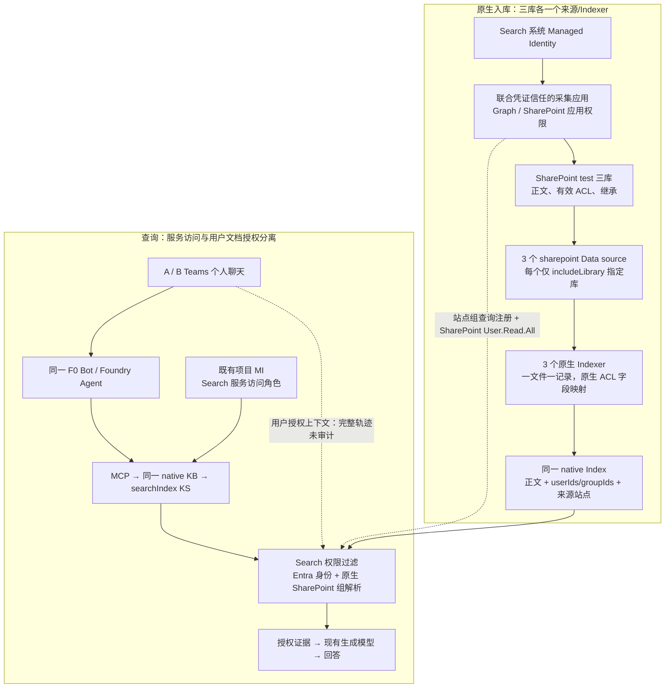

**三个 Data source/Indexer 合用一个 Index**：三库权限不同，但字段和处理方式一致；各来源单独限定、运行和留证，不必为 A/B 建不同 Index。当前没有 Skillset，原生文档解析直接写入一文件一记录；这不是完整长期调度方案，Indexer 结束后均禁用、无定时计划。

后续若添加 Text Split，必须把 `/document/metadata_user_ids`、`metadata_group_ids`、来源路径和来源站点投影到**每个 chunk**。`skipIndexingParentDocuments` 模式下仅给父级做 fieldMappings 不够；新旧 chunk 的更新、删除和权限传播也须测试。本轮未增加 Skillset、向量模型或重跑入库。

## 3. 身份、权限与真实 scope

### 3.1 Azure RBAC 与服务身份

scope 简称按下表展开：

| 简称 | 实际 ARM 路径 |
| --- | --- |
| SUB | `/subscriptions/3456866f-6478-471f-8d59-a29a335d797a` |
| SEARCH | SUB + `/resourceGroups/aks-test/providers/Microsoft.Search/searchServices/search-service-ypy2` |
| NATIVE-INDEX | SEARCH + `/indexes/teams-acl-demo-sp-native-index` |
| PROJECT | SUB + `/resourceGroups/rg-admin-3283/providers/Microsoft.CognitiveServices/accounts/admin-3283-resource/projects/teams-acl-demo` |

| 身份 | 标识与用途 | 角色 / scope |
| --- | --- | --- |
| admin | `admin@MngEnvMCAP566860.onmicrosoft.com`，OID `46832239-f08b-4172-96a2-59fd65cf193a`；配置/同意操作，不代测用户 | 既有 Search Service Contributor、Search Index Data Reader / SEARCH；订阅 Owner 和上级 UAA 管理权限不等于 Graph 应用权限同意能力。操作前另核实用户自行激活的 GA |
| Search 系统 MI | principal `2f5a902a-2160-4107-93ef-7cd20f88760d`，client `1daa1e7b-aa19-4620-9916-6f40452252e8` | 通过 FIC 获取采集应用 Token，读 SharePoint；不是最终用户或项目 MI |
| Foundry 项目 MI | principal `9b0e1ace-4ecc-452f-b7fc-a79adea38851` | 既有 Search Index Data Reader / **SEARCH 服务级**，用于 MCP 服务访问，不代替用户 ACL |
| A | `gaussye@MngEnvMCAP566860.onmicrosoft.com`，OID `cb1985cb-b3aa-49ee-8601-a159e2f6406f` | 既有 Foundry Agent Consumer / **PROJECT**；文档授权另由源 ACL 决定 |
| B | `pengyongye@MngEnvMCAP566860.onmicrosoft.com`，OID `373e6941-bcf1-4392-889f-a69611797bc1` | 同上 Consumer / **PROJECT** |
| Native AgentIdentity | client/principal `c81c8174-31ab-4eb7-803a-47836ac7be41` | 与 native Bot `msaAppId` 绑定；不等于工具连接的项目 MI，未声称其全部间接角色已审计 |
| 临时 admin Data Contributor | 角色 ID `8ebe5a00-799e-43f5-93ac-243d3dce84a7` | **仅 NATIVE-INDEX**，配置/诊断/回填后精确删除并 GET 核实；未扩大到 Search 服务级 |

临时 assignment 末段及清理证据：`feed2af7-ae02-4f0b-932b-4680c5d89788`、`3a81f4ef-7d6d-4e04-9480-918394f70bac`（原生运行）；`bcf240da-3ece-4428-8604-977faa248872`（父会话计数诊断）；`ade4f263-2df0-4f51-8ff2-36487d99dc96`（站点回填）。都已报告精确删除/不存在；admin 的既有管理能力仍保留。角色核对不是所有组、PIM、deny 或间接授权的完整评估。

### 3.2 采集应用与联合凭证

应用 `teams-acl-demo-sp-native-ingest`：client `7effa646-d029-4073-b39a-1f11946e757e`，object `28852a30-8f69-436c-b3dc-8b345a072def`；service principal `695720c7-acf0-4f87-8dfd-a96c7e6476e3`。

| API / 信任 | 实际配置 |
| --- | --- |
| Microsoft Graph application permissions | `Files.Read.All` + `Sites.Selected` |
| SharePoint application permissions | `Sites.Selected`；查询阶段另批 `User.Read.All`，不是 Graph User.Read.All |
| test 站点授权 | 应用 **Read**；父会话通过获批 Graph Explorer 单次 POST201完成，没有提升 Full Control |
| FIC | `search-system-mi`；issuer `https://login.microsoftonline.com/72c10632-ee48-4c08-a16a-e6cea1dbb7ef/v2.0`；subject 为 Search MI **principal ID**；audience `api://AzureADTokenExchange` |

`Files.Read.All` 是租户级应用权限，**includeLibrary 和 Sites.Selected 不消除这项广度**。此应用/FIC/同意/站点 Read 为获批保留的持久配置，不是“临时角色已清理”就全部撤销。父会话用于站点授权的 Graph Explorer 临时委托同意已精确移除并签出。

Data source 的 `ApplicationId` 是采集 app client ID，`FederatedCredentialApplicationId` 是 **Search MI client ID**，不是 FIC 条目 ID 或 MI principal ID。没有保存 client secret。

### 3.3 查询权限字段

| Index 配置 | 作用 / 实际状态 |
| --- | --- |
| `permissionFilterOption: enabled` | 启用原生权限过滤 |
| `userIds` / `groupIds` | 各有对应 `permissionFilter`，`filterable: true`、`retrievable: false` |
| `metadata_spo_item_path` | 保留原生来源路径，`retrievable: false`，不能作为文档键或普通客户端公开字段 |
| `SharePointSiteUrl`（旧字段） | 保留，未能事后修改其站点标记 |
| `NativeSharePointSiteUrl`（新增） | `sharepointSiteUrl: true`、不可返回；三条记录只 merge 回填正确 test URL，没有改变正文/ACL |
| `sharePointConnectorAppRegistration` | `applicationId` = 采集 client，`federatedCredentialId` = Search MI client，`tenantId` = 指定 SharePoint 租户 |
| `native-acl-semantic` | 标题 `metadata_spo_item_name`、正文 `content`；既有字段均 searchable，未改其 schema |

Search 服务访问通过项目 MI；最终用户授权上下文应经 `x-ms-query-source-authorization` 传递，Entra/SharePoint 组解析由 Search 执行，模型不决定授权。两边答案正确和字段非空并未独立证明底层所有身份/ACL 决策；native 的具体 ACL ID、owners-only 语义没有逐一返回核对。

**未来运行注意：** 当前 Indexer 映射来源站点到旧 `SharePointSiteUrl`，新增字段本次只回填既有三条。后续调度前应把 `metadata_spo_site_url` 映射到新的标记字段并验证更新行为；这是未执行的建议，不能直接开启计划后假定新文件站点上下文完整。

## 4. 配置顺序与 Portal 核对

### 4.1 已部署对象

| 组件 | 名称 / 实际配置 |
| --- | --- |
| Search | `search-service-ypy2` / `aks-test`，Basic / West US / 1 replica / 1 partition，未扩容 |
| Index | `teams-acl-demo-sp-native-index`，3 records，原生 ACL + 站点字段 + `native-acl-semantic` |
| 3 个 Data source | `teams-acl-demo-sp-native-public-ds`、`…-finance-ds`、`…-hr-ds`，均 `type: sharepoint`，各一个精确 includeLibrary |
| 3 个 Indexer | `teams-acl-demo-sp-native-public-indexer`、`…-finance-indexer`、`…-hr-indexer`；同一目标 Index，均 disabled、schedule null |
| KS / KB | `teams-acl-demo-sp-native-ks` / `teams-acl-demo-sp-native-kb`；searchIndex、单源、minimal / extractiveData、models 空 |
| MCP 连接 | `teams-acl-demo-sp-native-kb-mcp`，RemoteTool / ProjectManagedIdentity / Search audience，`isSharedToAll: false` |
| Agent / Bot | `teams-acl-demo-sp-native-agent` v1 / `teams-acl-demo-sp-native-bot` F0 SingleTenant，MsTeamsChannel enabled |
| 项目 / 生成模型 | 复用 `teams-acl-demo` / `gpt-4.1-mini` GlobalStandard `2025-04-14` |
| Teams Shared 发布 | app `39ec0383-559d-40c1-9548-69bd77b3e5ee`，title `T_d8bbb8e8-748d-7043-1879-c96074166887` |

Search 原生资源 API 使用 `2026-10-01`；实际 Foundry MCP target 读回为：

```text
https://search-service-ypy2.search.windows.net/knowledgebases/teams-acl-demo-sp-native-kb/mcp?api-version=2026-08-01-preview
```

这是原生 Foundry 发布，不是自建 Bot 后端；Shared 启用 BotServiceRbac，不是组织商店审批或 tenant-wide 可见。A/B 复用项目 Consumer 权限，个人安装不是新 Entra 管理员同意。

### 4.2 原生入库定义要点

Data source 示例以 Public 为代表，其余两库结构一致，仅名称和 includeLibrary 不同；占位符不是可直接执行的凭证。

```json
{
  "name": "teams-acl-demo-sp-native-public-ds",
  "type": "sharepoint",
  "indexerPermissionOptions": ["userIds", "groupIds"],
  "credentials": {
    "connectionString": "SharePointOnlineEndpoint=<test site>;ApplicationId=<ingestion client>;FederatedCredentialApplicationId=<Search MI client>;TenantId=<tenant>"
  },
  "container": {
    "name": "useQuery",
    "query": "includeLibrary=https://mngenvmcap566860.sharepoint.com/sites/test/TeamsAclDemoPublic"
  }
}
```

Indexer 使用 `.docx`、`contentAndMetadata`，`maxFailedItems: 0`、`maxFailedItemsPerBatch: 0`。关键映射：

| 来源字段 | 目标 |
| --- | --- |
| `metadata_spo_site_library_item_id` | `id`，使用 `base64Encode` |
| `metadata_user_ids` | `userIds` |
| `metadata_group_ids` | `groupIds` |
| `metadata_spo_site_url` | 旧 `SharePointSiteUrl`；新增标记字段是后续最小回填，不是来源已自动映射正确 |

实际顺序：检查身份/碰撞 → 新 app/FIC/同意/test Read → Index/3 DS/3 disabled Indexer → 逐个单次启用/运行后禁用 → stats/ACL非空核对 → 另批站点查询权限/字段修复/语义配置 → KS/KB/MCP/Agent/Bot Shared 发布。不要重放已经成功的创建器或运行请求。

### 4.3 Portal 导航与配置截图

以下 **7 张原生 Search 配置图**实拍于 **2026-11-24 11:26–11:38 UTC+8**，最后 **1 张 Foundry Agent 配置图**实拍于 **11:44 UTC+8**，不是旧 Push 截图或创建向导。仅读取部署后的配置/既有历史，已裁掉浏览器栏、账号及非原生页面内容；未点击 Save、Run、Publish，未输入检索或模型问题。Portal 已通过获批的既有 admin SSO 恢复。Foundry 登录点击曾因 Edge 用户活动中断而停 UI；用户明确停止所有 Edge 操作后，重新观察已登录页面并从账户菜单核实指定 admin，未重复登录或处理密码/MFA。

| 原生页面 | 导航 / 要核对的内容 | 状态 |
| --- | --- | --- |
| Index Fields | Search → Indexes → native Index → Fields；3 records、不可返回的 ACL/站点字段 | 已实拍 11:26 |
| Semantic configurations | 同一 Index → native-acl-semantic 的标题和正文 | 已实拍 11:27 |
| Public Data source | Search → Data sources → native-public-ds；SharePoint、系统 MI、单库范围 | 已实拍 11:29 |
| Public Indexer | Search → Indexers → native-public-indexer → Settings / Execution history | 已实拍 11:31，两图 |
| KS | Search → Knowledge sources → native-ks → Advanced configurations | 已实拍 11:33 |
| KB | Search → Knowledge bases → native-kb → Edit knowledge base (JSON)，仅查看后 Cancel | 已实拍 11:38 |
| Agent | Foundry → teams-acl-demo → Agents → native Agent → Playground | 已实拍 11:44 |

**Index 与语义配置。** Fields 显示 3 条记录，`userIds`、`groupIds` 及站点字段不可返回；部分长字段名被 Portal 列宽截断，完整名称/标记以 §3.3 和保存的 schema 读回为准。语义图显示 `metadata_spo_item_name` 标题、`content` 正文。

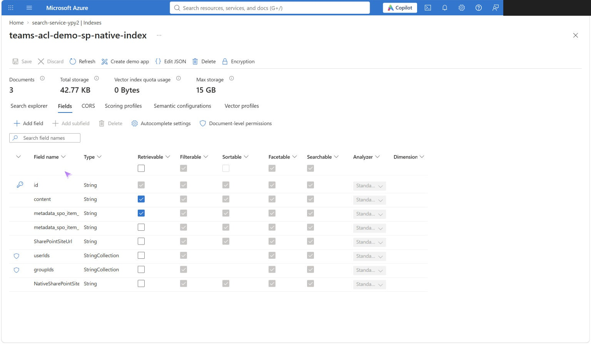

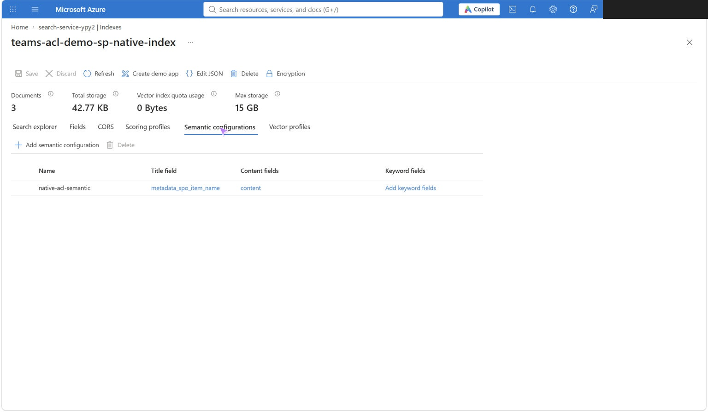

**Data source。** Public 代表图显示实际采集 app、tenant、System-assigned MI、test endpoint 和 document-level permissions。Query 尾部在 UI 中截断；完整 `includeLibrary=…/TeamsAclDemoPublic` 已从只读界面及保存定义核对，见 §4.2。Finance/HR 同结构，仅库/对象名不同；FIC 信任关系见 §3.2，不声称此页显示完整 FIC。

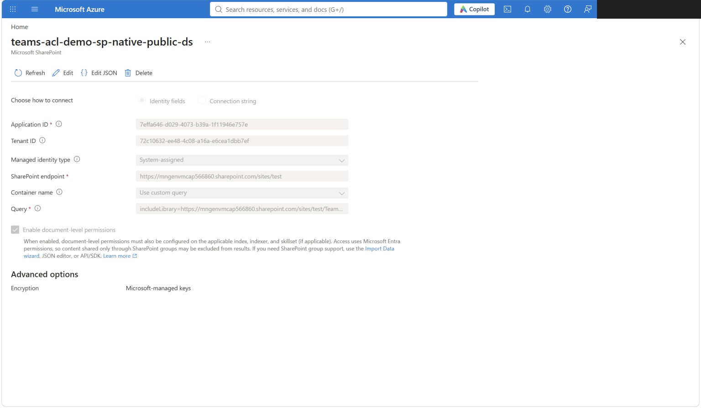

**Indexer。** Settings 绑定 native Public DS 和同一 native Index，Skillset 为空；UI 的 Once 对应无周期计划。`disabled: true` 来自保存的独立读回，不由 Run 按钮外观推断。此页的 document-level permissions 通用复选框未勾选；实际摄取使用 DS 的 `indexerPermissionOptions` 和 §4.2 显式 ACL 字段映射，不能据此图声称所有 SharePoint 组语义通过。历史图只有一次 Success，成功文档1、错误0/警告1；警告并未隐藏。

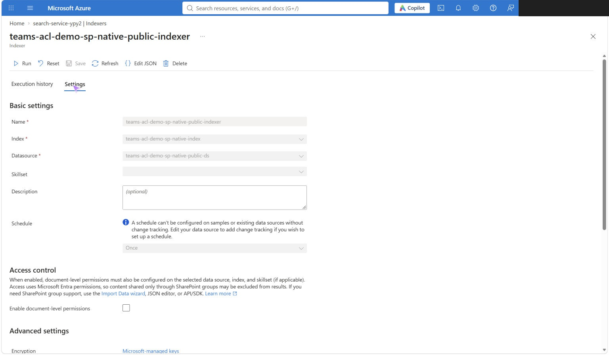

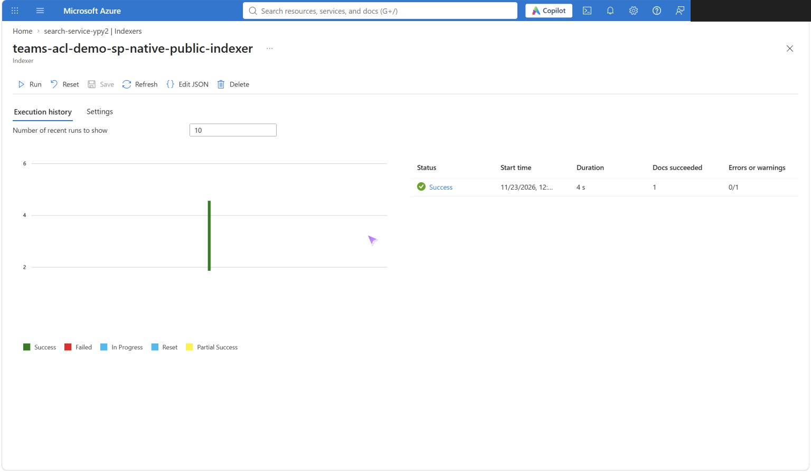

**KS / KB。** KS 明确绑定 native Index、`content` search field 和 `native-acl-semantic`。KB 图来自部署后 JSON 查看页，显示唯一 native KS、`models: []`、`extractiveData`、`minimal`；没有编辑或保存，随后 Cancel 退出。

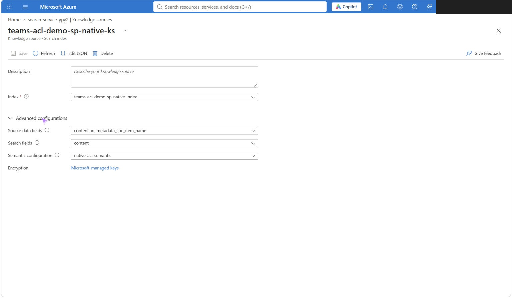

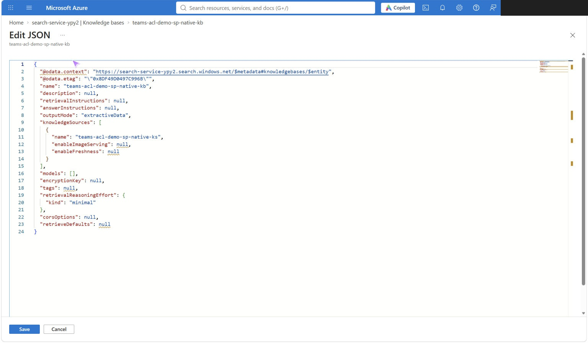

**Agent。** 最后实拍显示 `teams-acl-demo-sp-native-agent`、Version 1、`gpt-4.1-mini` Global Standard、既有指令及唯一 native KB。裁掉上方账户/订阅区域和左侧全局导航；右侧聊天输入保持为空。页面的 playground routing 提示只是当前 UI 提示，不是本轮新的模型调用或对 Teams 路由的验收。完整连接身份/发布对象仍以保存的 deployment readback 为准。

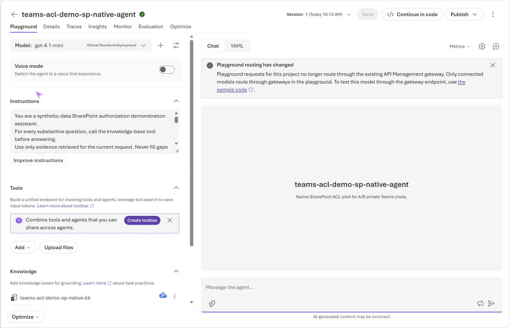

### 4.4 Teams 入口

实际可用入口以 **titleId 查询参数**打开应用，不是把 T_ 标识放进普通 app ID 路径：

[原生 Teams 应用](https://teams.microsoft.com/l/app/?source=agent-details-page&titleId=T_d8bbb8e8-748d-7043-1879-c96074166887)

以下应用详情实拍于 **2026-11-24 10:30 UTC+8**，已裁掉账号及旧聊天背景。仅证明 A 可发现详情；后来 A/B 由用户手工安装，助手没有重复 Add。

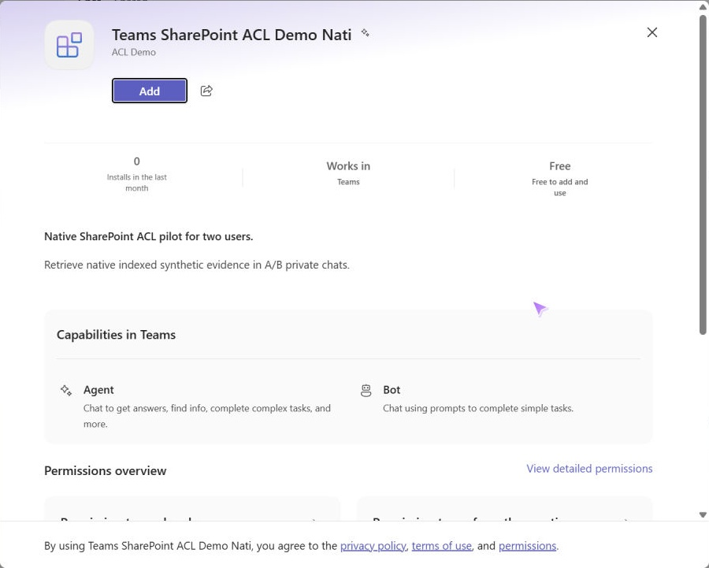

## 5. 真实测试结果与证据边界

### 5.1 入库与 ACL presence

2026-11-23，各 Indexer 只完成一次执行（时间 UTC+8）：

| 来源 | 执行时间 | 结果 |
| --- | --- | --- |
| Public | 12:59:41–12:59:46 | success，处理1、失败0、errors为空 |
| Finance | 13:00:06–13:00:09 | success，处理1、失败0、errors为空 |
| HR | 13:00:31–13:00:32 | success，处理1、失败0、errors为空 |

即时 stats 曾为0，GET-only 等待后独立读回3，没有重新入库。三者都出现 ACL 配置自动开启文件夹权限传播的警告，本轮未测试权限变化传播。

父会话另获批准执行两次 elevated **count-only/top0** 查询：`userIds/any()` 和 `groupIds/any()` 各 count3、value空。这证明两个字段在三条记录上均非空，不证明 ACL 主体/owners-only 语义正确。字段仍不可返回，未输出正文或 ACL ID。

### 5.2 A/B 同题私聊

```text
What are the Project Cedar FY27 allocations and verification codes in the documents I can access? List each allocation with its source document name. Use only retrieved evidence.
```

| 用户 | 原问题 / 登录卡 / 答案 ID | 实际答案 |
| --- | --- | --- |
| A | `1795487927318` / `1795487929920` / `1795488015460` | Public1000/CEDAR-P731 + Finance4200/CEDAR-F482；对应DOCX名称正确，未观察到HR |
| B | `1795489259374` / `1795489262628` / `1795489378419` | Public1000/CEDAR-P731 + HR7300/CEDAR-H965；对应DOCX名称正确，未观察到Finance |

用户各自完成 Foundry 登录，助手不代填密码/MFA、不以 admin 代测。A 10:38提问，答案显示10:40；B 11:00提问，答案显示创建时间11:02、实际spans11:03，不把消息创建时间当回答完成时间。B popout 显示陈旧，主窗口读回原题答案；没有因此补发。

A 成功结果图补拍于 **10:41 UTC+8**，仅保留正确 native 应用、原问题、登录完成及答案：

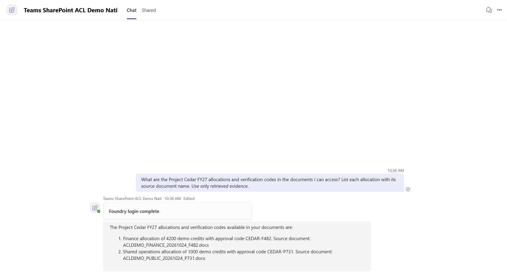

B 成功图补拍于 **11:09 UTC+8**，保留原问题/答案和随后额外观察到的问题，未伪装为单次成功：

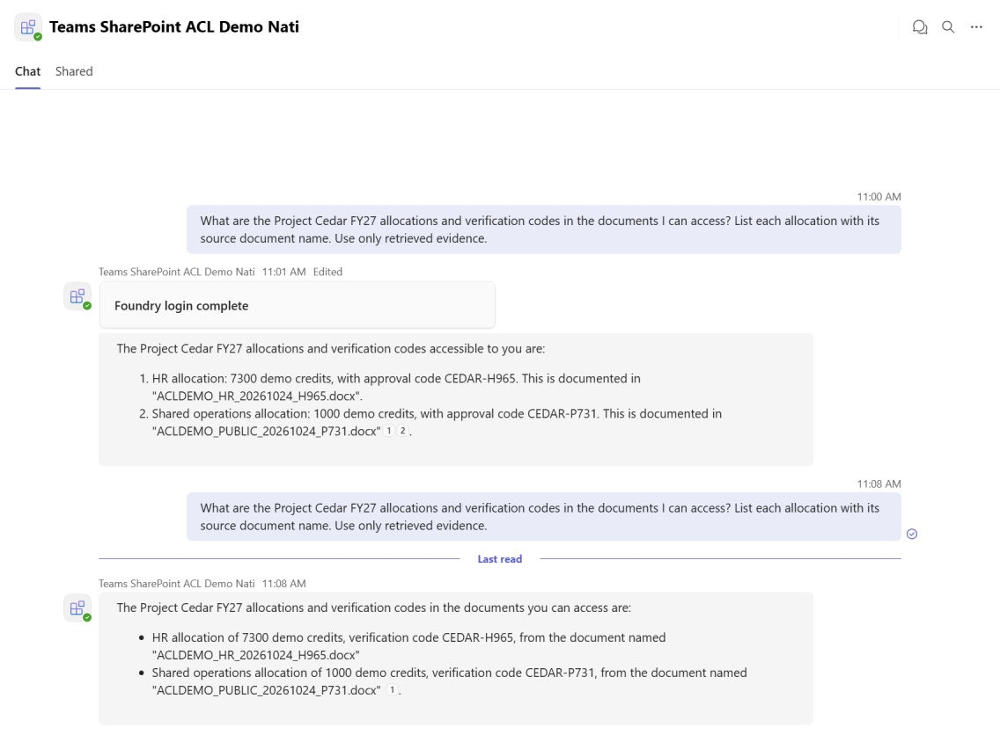

**实际消息数：** 原批准2条，助手只发送A/B各1条；后来观察到额外B问题 `1795489687123`（11:08）及答案 `1795489688833`，不是本助手发送，来源未独立确认。仍计入实际总数 **3条（A1/B2），超过原2条上限**。额度为0，不再提问或追加检索。

### 5.3 既有遥测

仅按新 native Agent 和两段时间窗查询现有 Application Insights，未取prompt/工具参数：

| 测试窗（UTC） | 实际操作 | 工具耗时 |
| --- | --- | --- |
| A：02:37–02:44 | 同一 operation 的成功 invoke_agent、execute_tool MCP retrieve、chat | 4207.6ms |
| B：02:59–03:08 | 同一 operation 的成功 invoke_agent、execute_tool MCP retrieve、chat | 2650.9ms |

共6条成功spans，支持本次工具/模型真实执行；不是完整计费次数、端到端耗时、精确 Teams 消息绑定或逐 ACL 判定轨迹。未为额外B问题新增日志查询。

## 6. 问题、修复与未验收项

| 现象 | 处理 / 边界 |
| --- | --- |
| admin GA不在活动列表 | 停写；用户自行激活后实时复核，不自动PIM或换账号 |
| GA存在但 Graph site grant403 | 管理令牌缺对应委托scope；父会话另批Graph Explorer完成test Read，清理其临时委托同意；不提高站点角色 |
| disabled Indexer不能手工run | 初次请求被拒且历史为空；随后仅启用各一次，由服务触发初始run，结束后禁用，无重复POST |
| `CannotChangeSharepointSiteUrl` | 旧字段属性不可改；另批新增NativeSharePointSiteUrl并仅merge三条站点URL，不重建/重跑 |
| KS要求目标Index有语义配置 | 另批仅现有标题/正文的native-acl-semantic；服务添加rankingOrder默认值导致首次严格相等误报，按必需属性读回确认，无重复PUT |
| B输入显示meeting chat禁用 | 不强行输入/改策略；用户另开可用native个人chat后才发题。历史截图不是失败的ACL查询 |

**执行范围失误必须保留：** 回填时批准的元数据投影是“ID/来源路径”；旧路径不可返回，助手改成 `id,metadata_spo_item_name`，在该微调单独确认之前执行了唯一 elevated metadata-only 查询和三次site-only merge。已如实报告并暂停；用户后续确认继续及语义配置，不改写为事前批准。未读取正文或ACL ID，未改ACL/content；临时角色已清理。

历史过程截图（不是成功验收图）：

<details>
<summary>A 登录等待和 B 旧入口禁用的实拍</summary>

A 登录等待，10:39：

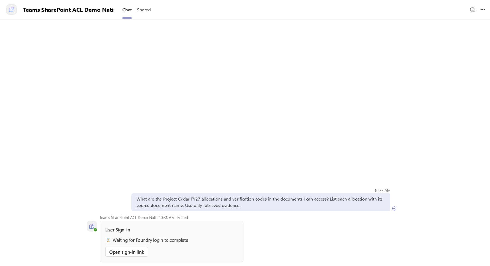

B 原应用pane输入禁用，10:50：

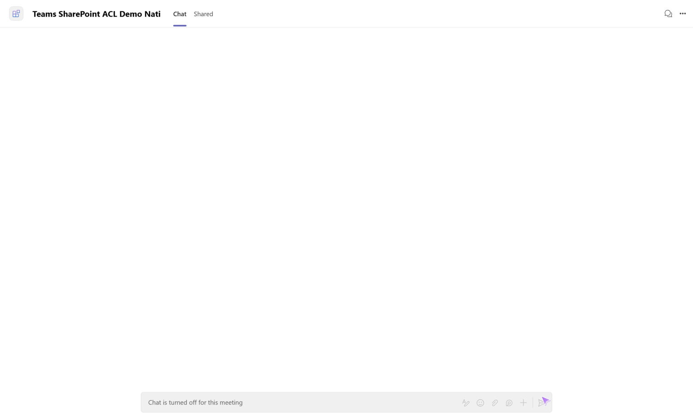

</details>

未验收：完整caller/逐项ACL决策、具体原生ACL ID与owners-only处理、缺失/过期身份与无fallback、来源链接逐一打开、任意历史/并发隔离、群聊/频道保护、增量/删除/撤权传播。新站点字段当前只回填了三条记录，未来同步前必须完善原生映射。正常正例和 CA 环境下单次成功不证明这些项目通过。

## 7. 代码、运行边界与证据

| 文件 | 用途 |
| --- | --- |
| `scripts/native_indexer_experiment.py` | 固定三库、身份/app权限/FIC/read grant、原生对象创建、限次运行、精确临时角色清理 |
| `scripts/native_site_field_repair.py` | 新标记字段、一次元数据读取、三条site-only merge、清理留证；已执行，勿重复 |
| `scripts/native_agent_deploy.py` | 原生查询权限与专用KS/KB/MCP/Agent/Bot/Shared发布，精确历史状态恢复 |
| `tests/test_native_*.py` | 配置、权限门槛、恢复范围和merge字段约束；本地测试不代替真实用户验收 |

本地验证命令，不发云请求：

```powershell
python -B -m unittest discover -s tests -p "test_*.py" -q
node --test .\tests\indexed-agent-config.test.mjs .\tests\indexed-browser-capture.test.mjs
```

本轮36个Python方法、10项Indexed Node测试通过；没有再次运行成功Indexer、重放部署或新增付费测试。源码输出和恢复参数不是通用更新工具，已有证据/对象即拒绝，使用前需核对scope和批准。

原始证据为被忽略的 `.azure/indexed/`，不随Git发布：

| 证据 | 文件 |
| --- | --- |
| 原生运行/计数/两次角色清理 | `native-run-enabled-20261123.json`、`native-post-run-verification-20261123.json`、`native-final-cleanup-20261123.json` |
| 原应用/FIC/3项摄取同意 | `native-created-readback-20261123.json` |
| 新SharePoint User.Read.All/字段不可变错误 | `native-e2e-deployment-resume2-20261124.json`、`native-e2e-field-immutable-20261124.json` |
| 站点字段回填与角色清理 | `native-site-field-repair-20261124.json` |
| 最终Agent/KS/KB/连接/发布 | `native-e2e-after-semantic-20261124.json`、`native-e2e-publication-readback-20261124.json` |
| 消息原文/ID/实际3题 | `native-e2e-teams-budget-20261124.json`、`native-e2e-handoff-20261124.json` |
| A/B最小遥测 | `native-e2e-A-telemetry-20261124.json`、`native-e2e-B-telemetry-20261124.json` |
| 父会话授权/ACL非空诊断 | 父worktree的 `native-site-grant-20261123.json`、`native-acl-counts-20261123.json`，不声称本worktree已复制 |

## 官方参考

- [SharePoint Indexer及CA限制](https://learn.microsoft.com/en-us/azure/search/search-how-to-index-sharepoint-online)
- [原生ACL摄取、字段投影与站点组查询](https://learn.microsoft.com/en-us/azure/search/search-indexer-sharepoint-access-control-lists)
- [查询时ACL执行](https://learn.microsoft.com/en-us/azure/search/search-query-access-control-rbac-enforcement)
- [Foundry Agent连接KB](https://learn.microsoft.com/en-us/azure/foundry/agents/how-to/foundry-iq-connect)
