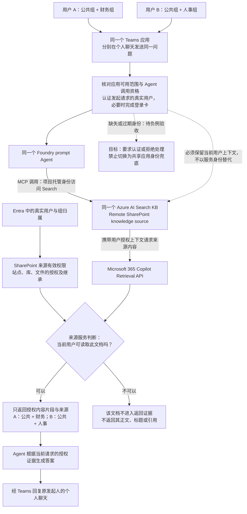
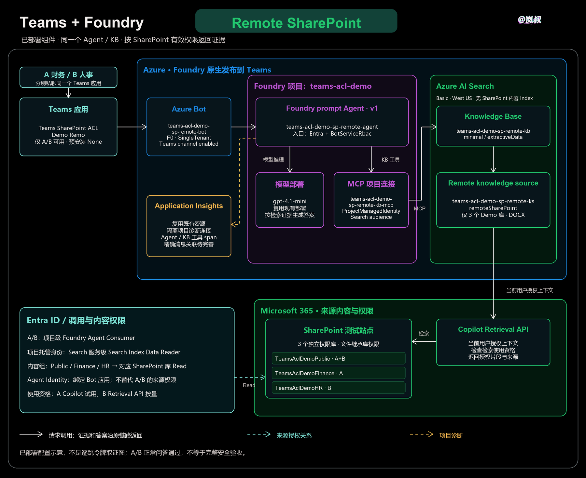

# Teams + Foundry + SharePoint：Remote 权限隔离 Demo

## 1. Demo 背景与目标

企业公共、财务、人事资料可以放在同一个 SharePoint 站点，但员工不应因为使用同一个 AI 助手，就看到所有部门的文档。本 Demo 用合成预算资料验证：**A/B 在 Teams 向同一个 Foundry Agent、同一个 Knowledge Base（KB）问相同问题，答案仍遵守各自的 SharePoint 权限。**

| 测试用户 | 实际内容安全组 | 可检索文档 | 不应出现的信息 |
| --- | --- | --- | --- |
| A，财务用户 | 公共：`sg-teams-acl-demo-public`<br/>财务：`sg-teams-acl-demo-finance` | 公共库、财务库 | 人事正文、标题、金额、校验码和引用链接 |
| B，人事用户 | 公共：`sg-teams-acl-demo-public`<br/>人事：`sg-teams-acl-demo-hr` | 公共库、人事库 | 财务正文、标题、金额、校验码和引用链接 |

这些是授予 SharePoint 库 **Read** 权限的 Entra 安全组，不是 SharePoint 内部 Owners/Members/Visitors 组，也不是计费组。管理员只用于获准的配置和诊断，不能代替 A/B 做普通用户权限验收。

**当前结论：Remote 的真实 A/B Teams 正常问答与对应引用检查已通过，完整安全验收尚未完成。** 本文只记录 Remote；Indexed 对比由独立文档维护，不混用测试结果。仅使用合成数据和个人聊天，不靠提示词或硬编码账号模拟 ACL。

## 2. 架构与权限机制

### 2.1 请求和授权流程

Remote 不把 SharePoint 文档及 ACL 复制到我们自己的 Search Index，而是通过 Search 中的 KB 调用 Microsoft 365 Copilot Retrieval API。下图说明权限职责；虚线表示所需用户上下文及待验证的异常分支，不是逐跳令牌取证图。



### 2.2 实际身份、角色和作用域

Azure RBAC 于 **2026-10-26 13:35 UTC+8** 只读核对，Bot 应用绑定和 MCP 认证配置也已核实。

| 身份 / 对象 | 本例用途 | 已核实角色、绑定与作用域 |
| --- | --- | --- |
| 用户 A、B 各自的 Entra 身份 | 调用 Agent，并保留各自的来源授权上下文 | 各有 `teams-acl-demo` **项目级** `Foundry Agent Consumer`；内容组归属见第 1 节 |
| 项目系统分配托管身份 | MCP 连接访问 Search 的服务身份 | 现有 **Search 服务级** `Search Index Data Reader`，不是单个 KB/Index 级；此次未读到 Data Contributor 角色 |
| Remote Agent Identity | 标识该 Agent 实例；Client ID 与 Azure Bot 的 `properties.msaAppId` 一致 | 实际绑定 Bot 应用；本例 Search 连接未选择它作为认证主体 |
| Agent Identity Blueprint / Blueprint Principal | Foundry 管理 Agent 身份、认证配置和生命周期 | 不是提示词模板或用户账号；权限声明不等于已授权 |
| 三个内容安全组 | SharePoint 内容授权主体 | 对应专用库 **Read**，文件继承库权限；不是 Azure RBAC |
| SharePoint `test Owners` | 保留来源管理权限 | 专用库 **Full Control**；不能据此认为该组为空或代表全部员工 |
| 指定 admin | 部署、角色管理和诊断；另做过 Playground 复测 | 其既有管理权限不作为 A/B 可读文档的依据，本表不展开完整管理员权限清单 |

同一 Search 作用域及其继承角色查询中，Remote Agent Identity 和 Blueprint Principal 均未返回赋权；这不是全租户、所有服务、组间接授权、PIM 或 deny assignment 的完整审计。

**服务有权调用 Search，不等于用户有权读取所有文档。** 文档范围还要靠当前用户上下文和来源有效权限。Path 过滤表达式限定 Demo 内容范围，但不是项目身份的 RBAC 作用域边界。

### 2.3 Knowledge、MCP 连接和入口授权不是同一项配置

| 配置对象 | 负责什么 | 本例配置 |
| --- | --- | --- |
| Search KB | 选择知识源、检索和返回证据 | 仅引用本路线 Remote source，minimal reasoning、`extractiveData` |
| Foundry 项目 Connection | 连接哪个 endpoint、使用什么服务身份 | `teams-acl-demo-sp-remote-kb-mcp`：`category: RemoteTool`、`authType: ProjectManagedIdentity`、`audience: https://search.azure.com/` |
| Agent 的知识绑定 | 使用哪个连接调用检索 | 门户 **Knowledge** 展示 KB；后台定义为 MCP，`server_label: knowledge-base`，通过 `project_connection_id` 引用上述连接 |
| Agent 入口授权 | 谁能调用 Agent | `agent_endpoint.authorization_schemes` 为 `Entra` + `BotServiceRbac`；前者服务直接 API 客户端，后者服务 Teams 通道 |

`--auth-type project-managed-identity` 是 `azd ai connection create` **创建项目连接**时的参数，不是创建 KB 时的参数。本 Demo 通过代码/API 创建连接；不能把通用 **Tools → 添加 MCP** 的界面路径当作 **Knowledge** 页的身份切换入口。

Agent 拥有独立 Agent Identity，不意味着所有工具调用自动使用它。其他受支持连接可选择 Agent Identity 认证，但本例没有切换；改身份和 RBAC 都需单独验证。

查找位置：Agent Details 的 **Identity & access** 看 Agent Identity/Blueprint；**项目资源**的 Identity 或 JSON `identity.principalId` 看项目托管身份；项目连接 JSON `properties.authType` 看实际认证方式；Search **Access control (IAM)** 看角色及 scope。

## 3. 环境与前置条件

### 3.1 用户许可与计费

Azure、Foundry、SharePoint 使用同一 Entra 租户，A/B 的基础 SharePoint/Teams 服务已就绪。Remote 检索用户还须有 Microsoft 365 Copilot 附加许可，或已启用 Retrieval API 按量资格；**E5、Teams、Copilot Chat 的可用性和管理员角色都不能替代该资格**。

| 用户 | 本例使用资格与当前记录 |
| --- | --- |
| A | 已分配并激活 Microsoft 365 Copilot 试用许可 |
| B | 已配置 Retrieval API 按量计费，使用独立组 `sg-teams-acl-demo-retrieval-payg-b` |
| admin | 初查无 Copilot 附加许可；用户随后自行加入同一按量组，2026-10-26 15:09 UTC+8 读回确认成员为 **admin+B**；用户复测反馈见第 5 节 |

按量启用前及使用期间，租户仍须至少保有一份 Microsoft 365 Copilot 许可。[许可与按量前提][remote-source]。计费组不授予 SharePoint 内容权限。现有 Search 固定费用继续，模型、检索、按量服务和日志可能分别计量；消息数量上限不是费用封顶，一次 KB 请求也不代表固定下游调用次数。

<details>
<summary>许可与计费配置截图（历史操作）</summary>

A 的用户许可行显示 Copilot 附加许可、Teams 和基础 Microsoft 365 许可，账号已遮挡。


B 的计费向导选择 **Specific group**，不是全部用户或人事内容组；这是配置步骤，不单独证明保存成功。


保存后显示 **Billing policy connection(s) updated / Connected**。图中历史组范围不代表之后 admin 加入前后的全部成员清单。


</details>

### 3.2 已部署组件

| 组件 | 本例配置 |
| --- | --- |
| Search | 复用现有 Basic 服务，West US，未为 Remote 新建内容 Index |
| Foundry | 独立项目 `teams-acl-demo`；复用模型部署 `gpt-4.1-mini` |
| Agent | `teams-acl-demo-sp-remote-agent`，prompt v1 |
| Knowledge source / KB | `teams-acl-demo-sp-remote-ks` / `teams-acl-demo-sp-remote-kb` |
| MCP 项目连接 | `teams-acl-demo-sp-remote-kb-mcp`，认证配置见 §2.3 |
| Azure Bot | `teams-acl-demo-sp-remote-bot`，F0、SingleTenant、Teams channel enabled |
| Teams 应用 | `Teams SharePoint ACL Demo Remo`；组织审核已通过，TAC 已读回仅 A/B 可用，预安装 None |
| 诊断 | 隔离项目连接既有 Application Insights，不新建监控资源 |

下图包含本表全部已部署组件，并补充下游 Retrieval API、SharePoint 三库及权限关系。2026-10-26 根据已核实配置绘制，不是逐跳令牌或实际时序取证；库内 A/B 标注只描述两位普通测试用户。



[查看动态版（GIF）](docs/images/remote/remote-system-architecture.gif) · [下载可编辑源文件（Excalidraw）](docs/images/remote/remote-system-architecture.excalidraw)

实际 endpoint 从相应资源读取；仓库不保存账号、租户/订阅 ID、令牌、登录链接或本地环境配置。

## 4. 部署步骤与门户截图

以下是实际完成的配置顺序，不是自动部署脚本或新的云变更授权。已有环境直接从第 5 节使用。

### 4.1 准备 SharePoint 文档与授权

在同一测试站点建立三个专用库：`TeamsAclDemoPublic`、`TeamsAclDemoFinance`、`TeamsAclDemoHR`。每库放一份合成 DOCX，文件名和预期值见 §5.1。

各库停止继承，移除默认 Members/Visitors 授权，授予对应 Entra 内容组 **Read**，保留 Owners **Full Control**；文件继承库权限。分别以 A/B 直接访问三份文件，核对可读正文与拒绝页的真实用户身份，不能把账号选择页当成访问拒绝。

以人事库为例，下图显示独立权限及 HR 组 Read。这不是 Owners 成员清单。


### 4.2 创建 Remote source 和 KB

复用 Search，通过 REST 创建 `remoteSharePoint` source，Path 过滤表达式只覆盖上述三个 Demo 库，限定 DOCX。KB 只引用该 source，使用 **minimal / extractiveData**，不配置 KB 的 LLM 查询规划或答案合成。

创建前检查重名和容量，创建后读回 source/KB 引用关系；不修改既有其他对象、共享服务容量或业务文档。

### 4.3 创建 Foundry Agent 与连接

创建独立 Foundry 项目，启用项目系统分配身份，按 §2.2 授权。在项目中创建 MCP 连接，目标为：

```text
https://<search-service>.search.windows.net/knowledgebases/teams-acl-demo-sp-remote-kb/mcp?api-version=2026-08-01-preview
```

Agent 绑定该连接，仅允许 `knowledge_base_retrieve`，`require_approval: never`。指令要求实质问题先检索，只依据当前请求的授权证据回答；失败时不编造、不自动重试。**这些指令不代替服务端权限执行。**

当前用户上下文由平台托管路径处理，没有自建 Teams SSO/OBO 后端，也没有显式 `search_auth_token` structured input 或 MCP 头模板。官方支持用户调用主体的动态源授权头，也提供显式传入方式；对应安全验证状态见第 7 节。[连接与用户上下文说明][iq-connect]。

### 4.4 配置 Bot 消息入口

Bot 应用 ID 绑定该 Agent 的 Client ID；消息 URL 为：

```text
https://<foundry-account>.services.ai.azure.com/api/projects/teams-acl-demo/agents/teams-acl-demo-sp-remote-agent/endpoint/protocols/activityProtocol?api-version=v1
```

**不能遗漏 `?api-version=v1`。** 本次修复只通过官方 Bot REST PATCH 修改 `properties.endpoint`，保留其他身份、网络和 Teams channel 设置。完整 Bicep 重放的 What-if 曾出现额外默认值漂移，**不要直接重放整份模板覆盖已发布 Bot**。

### 4.5 发布到 Teams 并核对用户范围

通过 Foundry **Publish → Teams and Microsoft Copilot → Direct publish → People in your organization** 送审，在 Microsoft 365 管理中心审核。按同一应用标识到 Teams 管理中心检查 Availability，仅允许 A/B，预安装 None；保存后重新读回，不以编辑器关闭作为成功证据。

下图是 **Requests 中当时的 Pending review**，不是当前最终发布状态。


历史策略页显示默认模板及角色限制提示。后续用户批准审核发布，但不代表所有模板保护均已生效；本次权限页没有新增管理员同意。


最终发布已读回 `approved / enabled`，入口仍为 **Entra + BotServiceRbac**，不能仅凭组织发布选项推断已变成 `BotServiceTenant`。目录 A/B 分配与技术上强制个人聊天是两回事，后者尚未验收。

### 4.6 启用可关联的诊断

项目已连接既有 Application Insights，连接 `isSharedToAll: false`。限定 Agent 和测试时间窗查询必要元数据，不记录令牌；连接不会补回旧请求。Component 曾报告 90 天保留、关联 workspace 报告 30 天，实际以工作区/表设置为准，未修改。

**截图说明：** 本文 6 张门户截图和 4 张 Teams 截图均为真实历史截图，2026-10-25 补入文档并脱敏；未记录精确采集时刻的不推断。没有保存到的 Agent/KB 创建页面不使用其他项目的图代替，也不为补图重新创建或发布资源。

## 5. 测试方法与实际结果

### 5.1 合成文档与统一问题

| 来源文件 | 合成内容 | 授权普通用户 |
| --- | --- | --- |
| `ACLDEMO_PUBLIC_20261024_P731.docx` | **1000** demo credits / `CEDAR-P731` | A、B |
| `ACLDEMO_FINANCE_20261024_F482.docx` | **4200** demo credits / `CEDAR-F482` | A |
| `ACLDEMO_HR_20261024_H965.docx` | **7300** demo credits / `CEDAR-H965` | B |

A/B 发送同一问题，不在问题中填入预期答案或另一组文件名：

```text
What are the Project Cedar FY27 allocations and verification codes in the documents I can access? List each allocation with its source document name. Use only retrieved evidence.
```

### 5.2 在 Teams 复现

1. 使用独立浏览器配置文件或隔离会话，分别核对 A/B 的完整 Teams 测试账号；不要只凭配置文件名判断身份，也不要操作公司的其他 Teams 会话。
2. 从 **Apps / Built for your org** 打开同一 Demo 的个人聊天，各发送一次统一问题。
3. 如出现 Foundry 登录卡，由用户使用**与 Teams 一致的账号**完成认证/MFA，等待 `Foundry login complete`。本次成功记录中原问题会继续处理，不必为完成登录补发一次。
4. 等待实际答案，逐项检查金额、代码、来源名称和引用目标；`Sent`、`Thinking...`、HTTP 200/202 都不能单独作为检索通过证据。
5. 若显示陈旧内容，刷新一次并重开同一聊天读回，不连续补发。仅在需要且已批准时使用 `/foundry_new_preview`，收到明确重置回执后再提问；旧 Foundry 会话不可恢复，不是日常演示必做步骤。

### 5.3 已执行结果

时间为 **UTC+8**。本次文档重排没有新增测试。

| 检查 | 实际结果 | 证据范围 |
| --- | --- | --- |
| A/B 直接访问三份来源文件 | A：公共/财务允许、人事拒绝；B：公共/人事允许、财务拒绝 | 已核对允许项正文及拒绝页身份，六项通过 |
| A Teams 同题私聊，2026-10-25 10:04 发问 | 公共 1000/P731、财务 4200/F482，代码和来源正确，未显示人事信息 | 已观察完整答案及登录完成卡 |
| B Teams 同题私聊，10:16 发问、10:17 答案 | 公共 1000/P731、人事 7300/H965，代码和来源正确，未显示财务信息 | 用户手动发送并登录，完整答案已核对 |
| 上述两答案的实际引用 | A 指向公共/财务，B 指向公共/人事，共四个目标匹配 | 只证明这两个答案，不承诺所有通道引用支持 |
| 既有会话重复提问，10:24/10:27 | A 仍为公共+财务，B 仍为公共+人事 | 可见内容通过；实际调用不重叠，不算并发或任意会话归属通过 |
| B 新会话，10:41 | 重置有明确回执；新答案仍为公共+人事 | 同一测试窗口有成功 KB 工具调用，见下文 |
| 本地测试记录 | 探针 31 项 + 配置 12 项，**43/43 通过** | 构造令牌/模拟响应及配置检查，不是真实运行时负例 |
| admin Playground，2026-10-26 | 初次文档问题为许可 403；用户自行加入计费组后反馈返回 Public、Finance、HR 三库内容 | **用户复测反馈**，未独立核对新答案正文、代码、引用或 trace；不能代替普通用户 A/B 隔离验收 |

B 新会话测试窗 **10:41–10:47** 的遥测包含成功 `invoke_agent`、子 `mcp_knowledge-base.knowledge_base_retrieve` 和后续模型调用，共享 operation/conversation 并有父子关联。KB 工具约 **5043.5 ms**，不是端到端耗时；尚未建立精确 Teams 消息到 trace 的绑定。

截至 2026-10-25 的 Remote **Teams** 批次累计 **12/16**：十条问题、两条命令，含早期失败尝试，不是十二次成功检索；不包含之后用户的 Playground 操作，也不是新的发送授权。

### 5.4 真实测试截图

以下为 2026-10-25 的既有问答。已裁去账号区和不必要链接浮层；A/B 归属依据测试前核实及本地证据，不由截图独立证明用户 object ID。图中引用编号也不单独证明链接目标。

**A：10:04 原问题、Foundry 登录完成及财务/公共完整答案。** 上方保留更早的失败尝试；原消息时间不是回答完成时刻。


**B：10:16 相同问题、登录完成及人事/公共完整答案。** 该问题由用户手动发送。


<details>
<summary>重复提问与新会话截图</summary>

A 的 10:24/10:27 答案均为财务和公共，不作为并发或每次新检索的证明。


B 的 10:40 重置命令后，10:41 收到 `Conversation reset. Send a new message to start a fresh thread.`，再同题回答人事和公共。图本身不证明后台工具调用，调用依据为 §5.3 遥测。


</details>

## 6. 常见问题与解决办法

### 6.1 为什么第一次发消息还要 Foundry login？

**Teams 是聊天入口，Foundry 是后面运行助手的服务。登录 Teams，不等于这条助手的用户登录已建立。** 原生通道会显示登录卡，确认用户身份后按 `BotServiceRbac` 检查调用资格；成功后通常复用状态，不需要每条消息或每天固定重登。

这是平台原生流程，不是我们加的登录代码，也不是让用户进入管理门户、登录成项目身份，或因为 SharePoint 文件拒绝访问才弹卡。`BotServiceTenant` 也有登录提示，改成它不等于消除首次登录。[官方通道授权说明][endpoint-auth]。

### 6.2 所有 Teams 应用和 API 调用都这样吗？

**不是。** 自建 Teams 应用可在支持且正确配置 SSO、满足同意/策略要求时减少额外登录；不能据此保证 Foundry 原生通道完全无感。

直接 API 调用不自动发聊天登录卡，由客户端先取得正确令牌并满足入口授权。本例直接 Entra 入口使用 `https://ai.azure.com` audience，与 Search 连接的 `https://search.azure.com/` 不同，不能拿 Teams/Graph 令牌混用。

用户型应用负责用户登录，后台程序可用获准服务身份自动认证；**服务免人工登录不等于自动拥有 A/B 的授权上下文**。要按用户权限检索，仍须正确传递该用户上下文，不能在问题里写用户名代替。[API 授权配置][endpoint-config]。

### 6.3 其他排障记录

| 现象 | 原因或已确认事实 | 处理与结果 |
| --- | --- | --- |
| admin 的 `hello` 正常，文档问题报错 | `hello` 未触发知识检索；KB 外层 BadGateway 的内层是 Copilot Retrieval API **403 / `Authorization Failed - User does not have valid license`** | 初查 admin 无 Copilot 附加许可且不在计费组；用户手动加入后，15:09 读回组含 admin+B，随后反馈能返回三库。不是修改模型、Agent Identity 或 Search RBAC 解决；结果边界见 §5.3 |
| Teams 显示 Sent，Bot 不回复 | 认证 GET 原消息 URL 明确报 `Missing required query parameter: api-version` | 获批只 PATCH `properties.endpoint` 追加 `?api-version=v1`，其余设置不变；后续出现登录卡和正常答案。未逐条关联全部早期失败消息 |
| 只改 URL，What-if 却出现更多变更 | 完整 Bot Bicep 重放涉及元数据/通道默认值漂移 | 未部署整份模板，改用单属性 PATCH，不用重建、扩权或改网络碰运气 |
| 已发布却提示找不到应用 | M365 Registry 与 TAC 曾读到不同可用范围 | 按同一应用 ID 限定 TAC 为 A/B，重新读回仅两用户；入口恢复，但未证明传播/缓存/范围变更中的唯一原因 |
| 角色已激活，管理入口仍禁用 | 用户自行激活已有资格后，旧会话仍不可用 | 单独批准重登同一 admin 后恢复；不是日常演示要反复重登的理由 |
| 上传 personal-only 定制包报通用 Error | 未完成部署，不能当作已上线 | 后续按批准使用原生发布版本；线上强制个人聊天仍待验证 |
| 发布向导提示部分策略不能分配 | 默认模板出现角色限制，具体失败原因未确定 | 先取消；后按用户明确批准审核发布，未新增同意。后续未再出现同警告，不等于全部策略已生效 |
| Foundry 登录卡一直等待 | 用户认证尚未完成，不能以 Teams 已登录代替 | A/B 各自完成后显示 `Foundry login complete`；不代填密码/MFA，不重复提交原问题 |
| B 自动输入被打断或无安全输入路径 | 未自动发送，不能假称送达 | 用户手动发送一次原问题并登录，再核对答案，没有重复补发 |
| Thinking 或页面内容陈旧 | 占位消息可原地编辑成最终答案，创建时间保留 | 刷新一次重开同一聊天读回；不据此推断完成时间或请求重叠 |
| 早期追踪为空或只有账号级状态码 | 没有可关联的 Agent/工具证据 | 获批连接既有 App Insights，后来读到工具 span；不补回旧请求，不以 200/202 或空日志推断成功/失败 |
| SharePoint 又要求选账号 | 是特定服务/浏览器的认证挑战，不代表所有会话失效 | 正确会话恢复可读后停止重试；未证明是 PIM 或缓存过期，不反复 logout/login，也不关闭 CA |

## 7. 验收边界与待测项目

正常答案正确，不等于所有安全路径都验证通过。当前只做**合成数据、A/B 个人聊天**；以下项目不冒充通过：

| 项目 | 当前状态 |
| --- | --- |
| 缺失/过期身份、认证失败、无 app-only fallback | 本地有模拟测试，**原生云运行时负例未完成** |
| Teams A、Foundry 登录 B 的账号错配 | **未实测**。如果 B 被接受为主体，检查的是 B 的调用权限；A/B 均有 Consumer，不足以证明账号一致性或回复去向安全 |
| 任意会话归属、历史隔离 | 重复提问的可见内容通过，**未完成归属负例** |
| 真正并发用户隔离 | 已观察调用不重叠，**不能算并发通过** |
| 线上强制个人聊天 | 原生成包包含 `personal`、`team`、`groupChat`、`copilot`；personal-only 草稿未发布。**A/B 可用名单不等于聊天范围保护** |
| 撤权与恢复传播 | **延期**。近 30 分钟未确认来源拒绝；自动恢复权限不足后，用户手动恢复 B 为人事组唯一直接成员，已读回与基线一致，无遗留临时撤权，但不算撤权验收通过 |
| 完整身份链与精确消息追踪 | 动态源授权头有官方依据、正例与工具窗有证据，**Teams Activity 到源授权头的逐跳映射及精确消息绑定未完成** |
| CA 适用性与传播 | 存在启用策略，不等于每个请求都被阻断或所有挑战处理已通过；不保证权限、组成员或来源缓存即时一致 |

恢复后也确认文件继承人事库权限、B 不是站点管理员；撤权未生效和自动恢复权限不足的根因仍未确定，不能归因于 PIM 过期。

令牌不得放进提示词、聊天、文件或日志。未知身份/认证挑战应停止并报告，不能切换 admin/app-only 兜底。原生通道对错配账号如何绑定仍须核实，不把通用 Teams SDK 的行为当成本例保证。后续测试、权限/发布变更和费用范围需要单独确认；当前不宣称生产就绪。

## 8. 附录

### 8.1 项目文件与本地测试

| 文件 | 用途 |
| --- | --- |
| `infra/main.bicep`、`infra/search-reader.bicep` | 独立项目、A/B Consumer 与项目身份的 Search Reader 配置 |
| `infra/bot.bicep` | F0 Bot 和 Teams channel 参数化模板，已有资源重放须先检查漂移 |
| `infra/observability.bicep` | 连接既有 Application Insights |
| `scripts/foundry-agent-config.mjs` | 生成 Agent/MCP/Bot 配置、校验 personal-only 草稿；不是已部署保护 |
| `scripts/remote-kb-probe.mjs` | 独立 KB API 探针，不是 Teams Bot，不自动登录或购买许可 |
| `tests/*.test.mjs` | 31 项探针测试和 12 项配置测试；使用 Node.js 内置测试能力 |
| `docs/images/remote/` | 6 张门户图、4 张 Teams 结果图，以及系统架构 PNG / GIF / Excalidraw 源文件 |

```powershell
node --test .\tests\remote-kb-probe.test.mjs .\tests\foundry-agent-config.test.mjs
node .\scripts\remote-kb-probe.mjs --help
```

本地测试不调用真实检索。探针真实执行需另行批准并显式加 `--execute`，以进程环境变量 `SEARCH_SERVICE_ACCESS_TOKEN` / `SEARCH_USER_ACCESS_TOKEN` 提供令牌，分别用于 `Authorization` / `x-ms-query-source-authorization`，不写入自然语言问题。JWT 字段检查仅用于诊断，不验证签名；401/403 不兜底重试，HTTP 206、内嵌错误、无效 activity、缺少授权标记/引用都不能误报通过。

此前独立公共客户端 `teams-acl-demo-user-probe` 仅配置 Search `user_impersonation` 及 A/B 专属 Principal 委托同意，没有创建密钥、Graph/Sites 权限或全租户同意。早期 A 请求虽 HTTP 200，但 source 标识校验未通过，B 探针未执行；独立探针暂停，其结果不作为 Teams 验收证据。

`.azure/` 的部署计划、私有证据、登录缓存及环境配置不提交 Git；模板和 helper 也不是可直接覆盖线上环境的一键安装器。

### 8.2 Remote / Indexed 与 CA 的必要区别

| 路线 | 内容与权限由谁维护 |
| --- | --- |
| **Remote，本篇** | 经 Retrieval API 访问 Microsoft 365，不自建 SharePoint 内容 Index；需要用户使用资格，仍有 Preview、格式、限流及缓存传播限制 |
| Indexed，独立文档 | 维护 Search 内容/ACL 副本；每个 chunk 必须带真实 ACL，查询按用户过滤，源权限变化后须同步 |

官方**内置 SharePoint Indexer**不支持启用了 CA 的租户，原生 `indexedSharePoint` source 继承此限制。[Indexer 限制][sp-indexer]。这不等于 Search、SharePoint 或所有 Indexed 实现不可用；也不能由一次请求成功推断组合获得官方支持。本篇没有运行该内置 indexer。

CA 约束“这次访问须满足什么条件”，ACL 决定“可看哪些文件”，两者不能替代。Remote 不依赖上述 indexer，但不绕过 CA，也不为演示关闭策略。内置 indexer 的父级权限变更需显式 resync/resetdocs 后成功运行；自建 Push 入库需更新受影响文档。[ACL 同步说明][sp-acl]。

### 8.3 官方参考

- [Foundry IQ：KB 连接、MCP 与逐请求用户授权][iq-connect]
- [Agent Identity 与 Blueprint](https://learn.microsoft.com/en-us/azure/foundry/agents/concepts/agent-identity)
- [Agent 入口授权与原生通道登录][endpoint-auth]；[配置及 API 调用][endpoint-config]
- [MCP 认证方式](https://learn.microsoft.com/en-us/azure/foundry/agents/how-to/mcp-authentication)
- [Remote SharePoint 前提、许可与限制][remote-source]；[Retrieval API 按量配置][paygo]
- [SharePoint Indexer 支持范围][sp-indexer]；[ACL 摄取与同步][sp-acl]
- [Search 查询时权限执行](https://learn.microsoft.com/en-us/azure/search/search-query-access-control-rbac-enforcement)
- [Push API 写入真实 ACL](https://learn.microsoft.com/en-us/azure/search/search-index-access-control-lists-and-rbac-push-api)
- [Conditional Access](https://learn.microsoft.com/en-us/entra/identity/conditional-access/overview)；[OBO 认证挑战](https://learn.microsoft.com/en-us/entra/msal/dotnet/acquiring-tokens/web-apps-apis/on-behalf-of-flow#handling-multi-factor-auth-mfa-conditional-access-and-incremental-consent)
- [Teams Bot SSO](https://learn.microsoft.com/en-us/microsoftteams/platform/bots/how-to/authentication/bot-sso-overview)；[组织应用审核](https://learn.microsoft.com/en-us/microsoft-365/admin/manage/agent-requests)

[iq-connect]: https://learn.microsoft.com/en-us/azure/foundry/agents/how-to/foundry-iq-connect
[endpoint-auth]: https://learn.microsoft.com/en-us/azure/foundry/agents/concepts/agent-endpoint-authorization#bot-service-channel-authorization
[endpoint-config]: https://learn.microsoft.com/en-us/azure/foundry/agents/how-to/configure-agent-endpoint-authorization
[remote-source]: https://learn.microsoft.com/en-us/azure/search/agentic-knowledge-source-how-to-sharepoint-remote
[paygo]: https://learn.microsoft.com/en-us/microsoft-365/copilot/extensibility/api/ai-services/retrieval/paygo-retrieval
[sp-indexer]: https://learn.microsoft.com/en-us/azure/search/search-how-to-index-sharepoint-online#limitations-and-considerations
[sp-acl]: https://learn.microsoft.com/en-us/azure/search/search-indexer-sharepoint-access-control-lists
