# Teams + Foundry + SharePoint：Demo 操作与测试说明

## Demo 背景

企业的公共、财务、人事资料可能存放在同一个 SharePoint 站点，但不同员工拥有不同访问权限。把这些资料接入 Teams AI 助手后，**“能使用同一个 Agent”不应变成“能读取所有部门的文档”**。模型不能凭用户自报身份、提示词或统一的服务账号来决定谁可以看什么。

本 Demo 用三份合成的 Project Cedar FY27 预算文档，验证两个普通用户通过 Teams 向**同一个 Foundry Agent、同一个 Knowledge Base（KB）**提问时，答案是否仍遵守 SharePoint 的真实有效权限。本篇记录已实施的 **Remote SharePoint** 路线：查询时经 Copilot Retrieval API 访问来源，不复制 SharePoint 内容到本地 Search Index；Indexed 对比由独立文档维护，不混用测试结论。

## Demo 需求

| 测试用户 | 实际内容组归属 | 可以检索的文档 | 不应出现的资料 |
| --- | --- | --- | --- |
| A，财务用户 | 公共组：`sg-teams-acl-demo-public`<br/>财务组：`sg-teams-acl-demo-finance` | 公共库、财务库 | 人事正文、标题、金额、校验码和引用链接 |
| B，人事用户 | 公共组：`sg-teams-acl-demo-public`<br/>人事组：`sg-teams-acl-demo-hr` | 公共库、人事库 | 财务正文、标题、金额、校验码和引用链接 |

这里的三个 `sg-teams-acl-demo-*` 是 **Entra 安全组**，作为授权主体出现在 SharePoint 库的权限列表中：公共组对公共库、财务组对财务库、人事组对人事库分别具有 **Read** 权限。它们不是 SharePoint 内部的 Owners/Members/Visitors 组，也不是 B 的 Retrieval API 计费组。

1. **共用入口与检索链路。** A/B 使用同一个 Teams 应用、Agent 和 KB，问相同问题；不能分别部署两套助手或按账号写死答案。
2. **沿用来源权限。** 授权来自 SharePoint 文件的实际有效权限，包括所属组与权限继承；不能靠模型“自觉不回答”代替检索侧权限执行。
3. **分清两种身份。** 托管身份用于服务之间调用；最终用户身份用于判断可见文档，不能把 admin 或统一应用身份当成 A/B 的内容授权。
4. **隔离答案与会话。** 受保护内容只在发起人的个人聊天中返回，不把按某一人权限取得的内容发到群聊/频道，也不能从另一人的聊天历史补全答案。
5. **结果可核验。** 用真实 Teams A/B 问答、合成金额/校验码及实际引用目标检查结果，记录截图、问题与处理办法；本地测试不能冒充云端验收。
6. **异常时安全失败。** 缺失/过期身份、检索失败或认证挑战时，应拒绝或要求用户认证，不得回退 app-only 检索；这一项及会话归属、真正并发、线上强制私聊保护仍需独立验收，撤权测试按要求延期。

## 本 Demo 实际使用的身份、角色与作用域

以下是 **Remote 路线**的实际配置，不是产品所有可选认证方式的清单。Azure RBAC 于 **2026-10-26 13:35 UTC+8** 使用指定 admin 只读核对；Bot 应用绑定及 MCP 连接认证类型也已只读核实。查询没有新增、删除或修改任何权限。

### 身份用在哪里

| 身份 / 对象 | 本例对应项 | 实际用途 | 本例的角色或绑定 |
| --- | --- | --- | --- |
| 普通测试用户 A | 财务测试用户 | 登录 Teams / 完成 Foundry 登录卡，以自身身份提问 | 隔离项目上的 **Foundry Agent Consumer**；公共组 + 财务组 |
| 普通测试用户 B | 人事测试用户 | 同一个 Agent 的另一位用户，保留独立用户上下文 | 隔离项目上的 **Foundry Agent Consumer**；公共组 + 人事组 |
| **项目托管身份** | `teams-acl-demo` 的系统分配身份 | MCP 连接以它获取 Search audience 的服务访问令牌 | Search 服务上的 **Search Index Data Reader** |
| **Remote Agent Identity** | `teams-acl-demo-sp-remote-agent` 的实例身份 | Client ID 与已部署 Azure Bot 的 `properties.msaAppId` 一致，作为 Teams/Bot 应用身份绑定 | **应用身份绑定，不是给它授予 Search Reader**；本连接未选择它作为 Search 认证主体 |
| **Agent Identity Blueprint** | 上述 Agent 的身份蓝图及对应 Blueprint Principal | Foundry 管理 Agent 身份、认证配置和生命周期的基础设施，不是 A/B 用户或提示词模板 | 不是 SharePoint 内容授权；本次在 Search 作用域未查到其 Blueprint Principal 的直接/继承 RBAC 赋权 |
| 内容安全组 | `sg-teams-acl-demo-public`、`sg-teams-acl-demo-finance`、`sg-teams-acl-demo-hr` | SharePoint 库级授权的真实主体 | 对应专用库 **Read**；这是 SharePoint 权限，不是 Azure RBAC |
| `test Owners` | SharePoint 内部 Owners 组 | 保留来源管理权限；文件按实际继承关系取得有效 ACL | 专用库 **Full Control**；不能据此认为组为空或把它等同于全部员工 |
| 部署管理员 | 指定 admin | 获准的资源部署、配置、角色管理和诊断 | **不是 A/B 正常检索身份**；其既有管理权限不作为普通用户可读文档的依据 |

**身份是否存在、入口使用什么身份、工具连接使用什么身份，是三件不同的事。** Remote 与 Indexed Agent 的 Agent Identity 可以不同；本表不据此推断 Indexed 连接使用哪种身份。每条工具连接都应单独核对。

### 已核实的 Azure RBAC 绑定

| 被授权主体 | 角色 | 实际作用域 | 允许做什么 / 不代表什么 |
| --- | --- | --- | --- |
| A | `Foundry Agent Consumer` | Foundry **项目** `teams-acl-demo` | 提供项目范围的 Agent 消费/调用资格；不是 SharePoint 财务权限，也不是仅限某个文件或单一 Agent 版本 |
| B | `Foundry Agent Consumer` | 同一个 Foundry **项目** | 与 A 一样具有调用资格，但不会因此获得财务文档权限 |
| 项目系统分配托管身份 | `Search Index Data Reader` | 现有 **Search 服务** | 为 MCP 提供只读数据访问权限；此次读回未出现上传/更新文档的 Data Contributor 角色。**当前是服务级，不是单个 KB 或 Index 级隔离** |

本次还按 Remote Agent Identity 和 Blueprint Principal 查询了同一 Search 作用域及其继承角色，均未返回赋权。该结果只描述此次查询范围，不是它们在全租户、所有服务或所有组间接授权上的完整审计。管理员已有的订阅/租户管理角色也不在这张运行时最小绑定表中展开。

**只读角色不等于文档 ACL。** `Search Index Data Reader` 回答的是“这个服务主体可否调用 Search 数据接口”；A/B 可见哪些 SharePoint 文件，仍要由检索链路保留用户授权上下文并执行来源有效权限。三个 Demo 库的 Path 过滤表达式也不是这个 RBAC 角色的作用域边界。

### 哪个配置决定调用 Search 时使用谁

实际项目连接为 `teams-acl-demo-sp-remote-kb-mcp`：

```json
{
  "properties": {
    "category": "RemoteTool",
    "authType": "ProjectManagedIdentity",
    "audience": "https://search.azure.com/"
  }
}
```

Agent 的 MCP 工具通过 `project_connection_id` 引用这个连接，代码配置位于 `scripts/foundry-agent-config.mjs`。所以本例是 **Agent Identity 绑定 Bot 应用，项目托管身份认证 Search 连接，A/B 用户身份决定来源可见内容**；不是所有环节自动使用同一个身份。

查找时区分以下位置：Agent Details 的 **Identity & access** 查看 Agent Identity / Blueprint；Foundry **项目资源**的 Identity 或资源 JSON 的 `identity.principalId` 查看项目托管身份；项目 Connections 查看连接的 `properties.authType`；Search **Access control (IAM)** 查看该主体实际获得的角色与作用域。

### SharePoint 内容授权与用户登录

公共内容组包含 A+B，财务内容组包含 A，人事内容组包含 B；三个库各自具有独立 ACL，对应内容组为 Read，保留 Owners 的 Full Control，文件继承所在库权限。这是已核实的合成来源基线，参见 §0.2 的权限截图；**不是本次对全部来源权限重新执行实时审计**。

用户首次聊天出现的 `User Sign-in` 卡用于建立该用户在 Foundry 调用链路中的认证上下文，不是让用户登录成项目托管身份或 Agent Identity。Bot 的后台服务认证也不等于这张用户登录卡。

此处记录实际绑定及设计职责，**不把它当成逐跳令牌取证或完整安全验收**。更改连接为 Agent Identity 认证、增减 RBAC 或缩小作用域均属后续变更，需要单独验证和批准，本次没有执行。

## 权限流程图

下图说明本 Demo 的**权限职责与目标处理流程**，不是逐跳令牌报文的取证图。实线表示正常请求、授权判断和返回路径；虚线说明必须保留的用户上下文，以及仍待负例验证的异常分支。

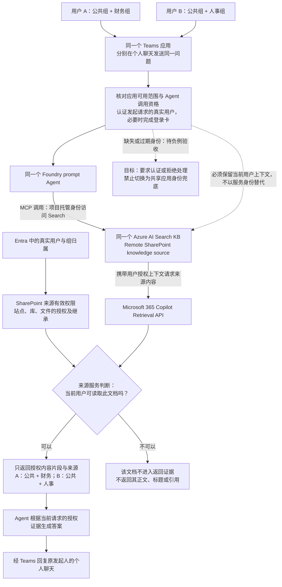

**权限关键点：** 应用分配只决定谁能找到/使用助手，Foundry 调用角色只决定谁能调用 Agent；真正可见哪些文档，由来源服务按**当前用户**的 SharePoint 有效权限判断。项目托管身份访问 Search 的权限不等于财务或人事内容权限；授权过滤发生在证据交给模型之前，而不是模型先看全部内容再决定隐瞒。

官方支持在调用主体为用户时动态设置 `x-ms-query-source-authorization`，也支持应用显式传入每请求上下文。[8] 本次已观察到 A/B 正确正例和测试窗口内的 KB 调用，但**Teams Activity 到源授权头的精确映射及缺失/过期上下文处理尚未完成取证**；图中的目标分支不应被读成已经全部验证通过。

## 当前实施状态

> **正常流程已跑通（2026-10-25）：真实 Foundry Agent 已发布到 Teams，A/B 使用同一个 Agent 和 KB 私聊同题，分别返回公共+财务、公共+人事，内容和四个引用目标符合预期。** 本次整理复核已有真实测试证据，未新增付费检索或测试消息。
>
> **当前范围：先完成正常流程与文档交接，撤权测试按用户要求延期。** B 的人事组成员资格已恢复并读回核实，无遗留临时撤权。正常正例通过不等于完整安全验收或生产就绪；身份负例、并发、会话归属及线上强制私聊保护仍待验证。

先阅读下面的操作手册。第 1–6 节解释架构选型，第 7 节折叠保存历史排障过程，第 8 节说明本地探针；历史中的阶段性“未完成”不代表最新正常流程状态。

## 0. 正常流程操作手册

### 0.1 实际部署的链路

```text
Teams 中同一个应用的个人聊天
  -> Azure Bot Service / Teams channel
  -> 同一个 Foundry prompt Agent（gpt-4.1-mini）
  -> MCP knowledge_base_retrieve
  -> Azure AI Search 中同一个 Knowledge Base
  -> Remote SharePoint knowledge source / Copilot Retrieval API
  -> SharePoint 中当前用户有权访问的 Demo 文档
```

这是 **Foundry 原生发布到 Teams** 的路线，不是自建 Bot 后端或本地模拟。Remote 路线没有创建 SharePoint 内容 Index，不使用 Work IQ，也没有绕过 KB 直接把 SharePoint 内容送给模型。

| 组件 | 本 Demo 使用的配置 |
| --- | --- |
| Foundry project | 独立项目 `teams-acl-demo` |
| Agent | `teams-acl-demo-sp-remote-agent`，prompt v1，`gpt-4.1-mini` |
| Teams 显示名称 | `Teams SharePoint ACL Demo Remo` |
| Azure Bot | `teams-acl-demo-sp-remote-bot`，F0、SingleTenant、Teams channel enabled |
| KB | `teams-acl-demo-sp-remote-kb`，minimal reasoning、extractiveData，仅引用下列 source |
| Knowledge source | `teams-acl-demo-sp-remote-ks`，remoteSharePoint |
| MCP 连接 | `teams-acl-demo-sp-remote-kb-mcp`，ProjectManagedIdentity，Search audience |
| 内容范围 | 仅三个专用 Demo 库中的 DOCX，使用 Path 过滤表达式，不检索整个业务站点 |
| 用户范围 | 组织应用已审核发布，Teams 管理中心已读回仅 A/B 可用；试点只在个人聊天操作 |

实际资源 endpoint 从对应 Foundry project、Search 和 Bot 资源读取；本文不保存测试账号、租户/订阅 ID、登录链接或凭证。
**ProjectManagedIdentity 是 Agent 连接 Search 的服务身份，不等于最终用户的 SharePoint 身份。** 当前官方文档支持用户调用上下文动态设置源授权头，也支持显式 structured inputs；本部署未配置显式用户令牌模板，不能仅凭这一点判定身份丢失，也不能仅凭正确答案宣布所有身份负例通过。[8]

### 0.2 搭建顺序与前置条件

这是已实际完成的配置顺序，不是再次执行资源修改的授权；已有环境从下一节开始即可，**无需重建、重新发布或反复登录**。

1. **确认管理身份和环境。** Azure 资源操作使用指定 admin，核对完整账号、租户及订阅；A/B 使用两个普通测试账号，不能以管理员代测。Azure 和 SharePoint 属于同一 Entra 租户。
2. **准备许可。** A 分配已激活的 Microsoft 365 Copilot 试用；B 使用获批的 Retrieval API 按量计费，并具有可用的基础 SharePoint/Teams 服务计划。B 的计费组与内容组分离。按量启用仍有租户 Copilot 许可前提，不要把 E5 或 Teams 许可当成 Copilot 附加许可。[12]
3. **准备合成内容和组。** 在同一测试站点建立 `TeamsAclDemoPublic`、`TeamsAclDemoFinance`、`TeamsAclDemoHR` 三个专用文档库；公共内容组包含 A+B，财务组仅 A，人事组仅 B。各库使用独立权限，对应内容组 Read，保留 Owners/Full Control，不扩大业务库权限。
4. **验证来源权限。** 每库上传一份下表列出的合成 DOCX，确认文件继承所在库权限。分别以 A/B 直接访问三份文件，既核对允许的正文，也核对拒绝页的实际用户身份；登录选择页不是拒绝访问证据。
5. **连接 Search 与 Foundry。** 复用现有 Search，创建 Remote source 和只引用该 source 的 KB；过滤表达式仅包含三个 Demo 库。创建独立 Foundry 项目、真实 prompt Agent 和 MCP 连接，使用现有模型部署；不为 A/B 增加共享 Search 的 RBAC。
6. **配置入口和发布。** 创建 F0 Azure Bot、启用 Teams channel。消息 URL 必须包含版本参数：`https://<foundry-account>.services.ai.azure.com/api/projects/teams-acl-demo/agents/teams-acl-demo-sp-remote-agent/endpoint/protocols/activityProtocol?api-version=v1`。通过 Foundry 的 `Publish → Teams and Microsoft Copilot → Direct publish → People in your organization` 送审。
7. **管理员审核并限制用户。** 在 Microsoft 365 管理中心审核本应用；本次发布未新增管理员同意。到 Teams 管理中心按应用标识核实 Availability，仅分配 A/B，预安装 None；保存后重新读回，不能只相信编辑器关闭或“已提交”。A/B 已在隔离项目具有 Foundry Agent Consumer 角色；不要授予无关项目权限。
8. **保留诊断能力。** 隔离项目已连接既有 Application Insights。仅在明确测试窗口查询该 Agent 的最小必要元数据，不打印或保存令牌，不用账号级 200/202 或空日志代替检索成功证据。

`infra/` 中的模板及 `scripts/foundry-agent-config.mjs` 是本项目配置资产，不是自动执行的端到端安装程序。已有 Bot 存在服务端默认值漂移，**不要直接重放整份 Bicep**；本次入口修复在 What-if 阻止额外变更后，仅 PATCH 了 `properties.endpoint`。

仓库保留参数化模板、脚本和测试；含实际环境标识的 `.azure/` 部署记录、令牌、登录缓存及本地配置不提交到 Git。

#### 门户步骤截图

以下均为实际操作中保存的历史截图，于 **2026-10-25 补入文档**，不是本次重新执行创建、授权或发布。未在原图记录精确采集时刻的，不推断其时间。账号、订阅和非必要环境信息已遮挡或裁去；图片只证明所标注的页面阶段，不代替最终配置读回或运行时验收。

**步骤 2：核对 A 的许可。** Microsoft 365 管理中心的 Active users 行同时显示 Copilot 附加许可、Teams 和基础 Microsoft 365 许可；用户名与显示名称已遮挡。

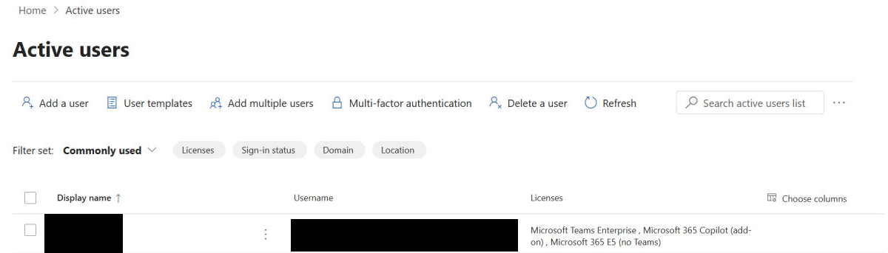

**步骤 2：B 的按量策略限定专用计费组。** `Choose users → Specific group` 选择的是 Retrieval API 计费组，不是全部用户，也不是人事内容授权组。此图是选择范围的向导步骤，不单独证明最终连接已保存。

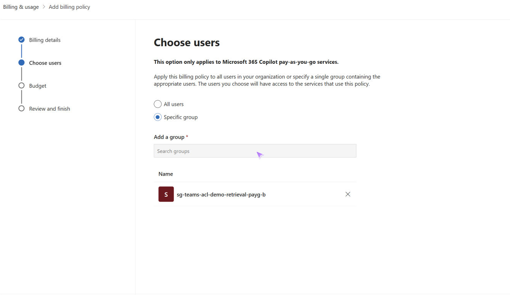

**步骤 2：保存 Retrieval API 计费连接。** 页面显示 `Billing policy connection(s) updated` 和 `Connected`；仅证明连接保存，不等于已产生检索结果或固定费用封顶。

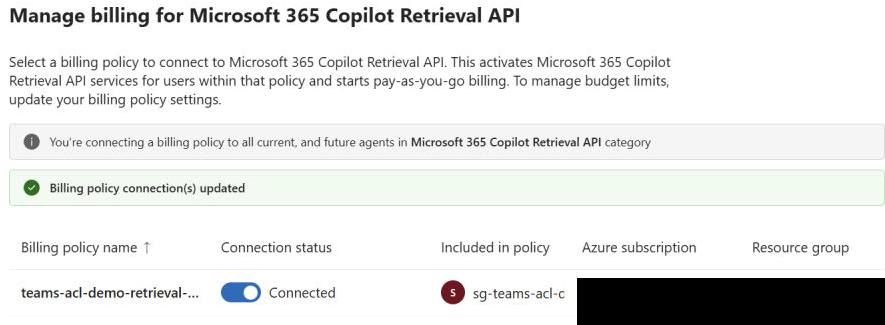

**步骤 3：核对专用库的独立权限。** 以人事库为例，显示 `This library has unique permissions`、人事安全组 `Read` 和 `test Owners` 的 `Full Control`。这张图不是 Owners 组成员清单，不代表该组为空。

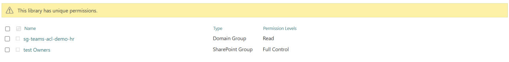

**步骤 6–7：找到组织发布请求。** Microsoft 365 管理中心的 `Agents → All agents → Requests` 列出本 Demo 的 `Pending review / Publish` 请求。这是**当时送审阶段**的历史画面，不能解释为当前仍待审，也不是最终已发布状态的截图。

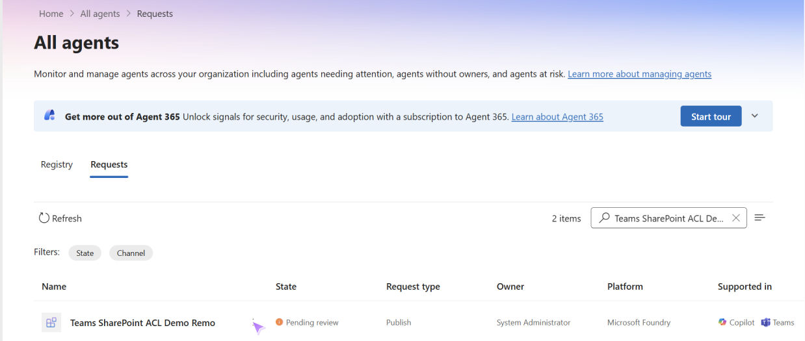

**步骤 7 / 问题记录：检查安全策略模板。** 历史审核向导显示默认模板及“当前角色不能应用自定义策略”的提示；对应 §0.5 的策略问题。不能仅因向导列出 CA 或 Access Package 就声称其已配置，也不能据此推断租户 CA 被关闭。

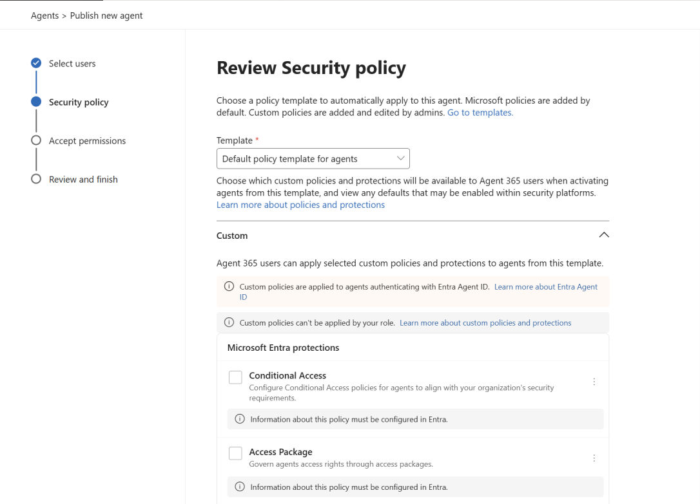

没有保存到的 Foundry Agent/KB 创建页面，不用其他项目或 Indexed 路线的图片代替。上述图片不是完整的逐点击部署录像；实际对象配置与最终状态以 §0.1、§0.4 的已核实记录为准。

### 0.3 在 Teams 复现正常问答

1. 使用两个独立浏览器配置文件或隔离会话，分别打开 A/B 的 Teams。核对 Teams 账号菜单中的完整测试账号，不以浏览器配置文件名称代替身份核实；保留已有正常登录，不操作公司的其他 Teams 会话。
2. 在 `Apps / Built for your org` 找到上表的应用，打开与该 Bot 的**个人聊天**。两个用户都使用同一个应用、Agent 和 KB，不分别创建两套 Agent。
3. 两个用户分别发送下面完全相同的问题，不在问题中填入预期金额、校验码或另一组文件名。

```text
What are the Project Cedar FY27 allocations and verification codes in the documents I can access? List each allocation with its source document name. Use only retrieved evidence.
```

4. **仅当 Bot 返回 User Sign-in 卡时**，由当前测试用户打开链接并完成该账号的认证/MFA，等待原卡显示 `Foundry login complete`。本次成功记录中，完成登录后原问题继续处理，没有为完成登录而重复发送问题。不要把 admin、A、B 混用，也不要将令牌粘贴到聊天。
5. 等待实际答案，不把 `Sent`、`Thinking...` 或 HTTP 202 当成成功。核对金额、校验码、来源名称和实际引用链接；不能出现另一组的正文、标题、金额、代码或链接。
6. 如客户端显示陈旧内容，可刷新一次并重新打开**同一**聊天读回，不立即补发问题。只有明确需要新 Foundry 会话且已获批准时，才用 `/foundry_new_preview`；必须收到 `Conversation reset. Send a new message to start a fresh thread.` 后再提问。该命令不可恢复旧 Foundry 会话，不是每次演示必做步骤。

**不需要每次重登。** Teams 登录、Bot 的 Foundry 用户登录、admin 的 SharePoint 管理会话和 Azure CLI 登录是不同环节；只处理真正发起挑战的环节。出现账号选择回环、密码/MFA 或新权限同意时停止自动重试，由用户处理具体挑战，不通过关闭 CA、扩大权限或切换为管理员来“跑通”。

### 0.4 实际测试结果

证据日期为 **2026-10-25，时间为 UTC+8**。以下来自真实 SharePoint/Teams 观察和保存在本地的机器证据，不是根据预期填写的结果。本次文档整理未新增 Teams 问题；A 的既有 10:24/10:27 答案在本次只读复核中仍显示财务和公共的正确内容。

| 检查项 | 实际结果 | 结论与边界 |
| --- | --- | --- |
| A 直接访问来源 | 公共、财务可读正文；人事拒绝访问，拒绝页为 A | 该三份合成文件的来源权限通过 |
| B 直接访问来源 | 公共、人事可读正文；财务拒绝访问，拒绝页为 B | 该三份合成文件的来源权限通过 |
| A Teams 同题私聊，问题 10:04 | 公共 **1000 / CEDAR-P731**；财务 **4200 / CEDAR-F482**；来源名称正确，未显示人事内容 | 正常内容检查通过 |
| B Teams 同题私聊，问题 10:16、答案 10:17 | 公共 **1000 / CEDAR-P731**；人事 **7300 / CEDAR-H965**；来源名称正确，未显示财务内容 | 正常内容检查通过；本次问题由用户手动发送 |
| 两个答案的引用目标 | A 指向公共、财务；B 指向公共、人事，共四个实际目标已核对 | 这两个答案的链接检查通过，不承诺所有通道的引用支持 |
| 既有会话重复提问，10:24/10:27 | A 仍返回公共+财务，B 仍返回公共+人事，未见另一组信息 | 可见内容检查通过，不等于任意会话归属或并发隔离通过 |
| B 新 Foundry 会话，10:41 | 重置有明确 Bot 回执；新问题仍只返回公共+人事 | 新会话正常内容检查通过 |
| B 新会话测试窗的工具调用 | 同一 Agent 的成功 `invoke_agent`、子 `mcp_knowledge-base.knowledge_base_retrieve` 和后续模型调用；KB 工具约 **5043.5 ms** | 确认测试窗内有真实 KB 调用；未建立精确 Teams 消息到 trace 的绑定，不作为端到端耗时 |
| 本地测试，本次重新运行 | 探针 31 项、Foundry/Bot 配置 12 项，共 **43/43 通过** | 本地测试，不代表已部署运行时的身份负例通过 |

| 来源文件 | 合成内容 | 授权用户 |
| --- | --- | --- |
| `ACLDEMO_PUBLIC_20261024_P731.docx` | 1000 demo credits，`CEDAR-P731` | A、B |
| `ACLDEMO_FINANCE_20261024_F482.docx` | 4200 demo credits，`CEDAR-F482` | A |
| `ACLDEMO_HR_20261024_H965.docx` | 7300 demo credits，`CEDAR-H965` | B |

本地复现命令（不发起真实云检索）：

```powershell
node --test .\tests\remote-kb-probe.test.mjs .\tests\foundry-agent-config.test.mjs
```

累计已发送 **12 条**，包括十条问题和两条命令，包含早期无回复尝试；**不是十二次成功检索**。既有发送上限为 16，但本次未使用剩余额度；该上限不是费用封顶，模型、Search、Retrieval API 和日志可能分别计量。

#### 真实 Teams 测试截图

以下为 **2026-10-25 既有测试**的真实截图，图中时间为 UTC+8；本次仅从已保存原图裁切、脱敏并嵌入，未增发问题或重新登录。为避免暴露账号，已裁去个人资料、浏览器标签和不必要的链接浮层；A/B 归属依据测试前身份核实及本地机器记录，不靠裁切后的截图单独证明用户 object ID。

**A：原问题与财务 / 公共答案。** 图中保留 10:04 的问题、`Foundry login complete` 及完整答案：财务 `4200 / CEDAR-F482`，公共 `1000 / CEDAR-P731`。更早的无回复尝试也保留在同一历史聊天画面中，不计为成功答案；消息的原始时间不是完整回答的完成时刻。

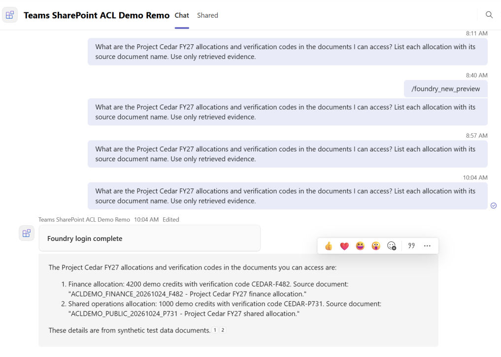

**B：相同问题与人事 / 公共答案。** 图中保留 10:16 的问题、登录完成卡及完整答案：人事 `7300 / CEDAR-H965`，公共 `1000 / CEDAR-P731`。该问题由用户手动发送，未用管理员代测。

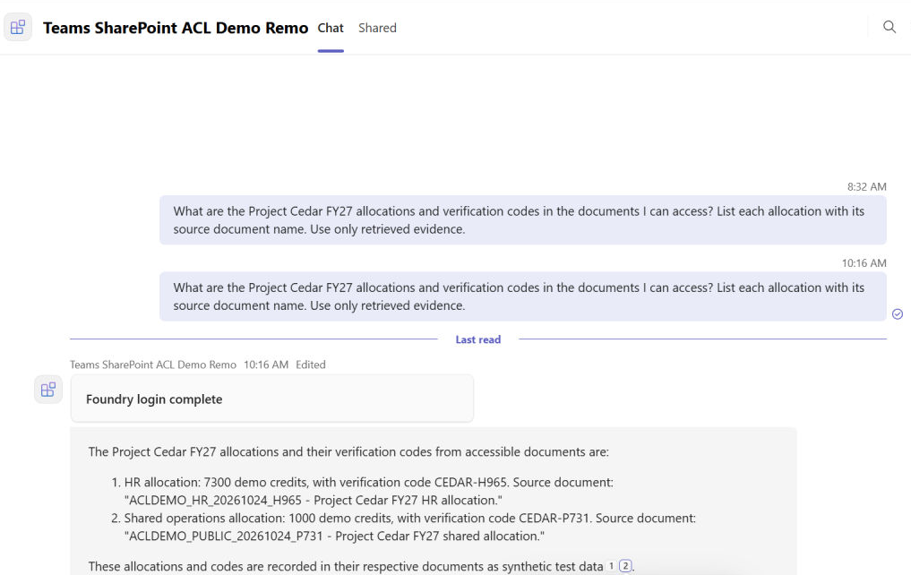

**A：既有会话重复提问。** 10:24 和 10:27 两次可见答案仍只含财务与公共。此图证明对应答案内容，**不证明请求实际并发或每次都重新调用 KB**。

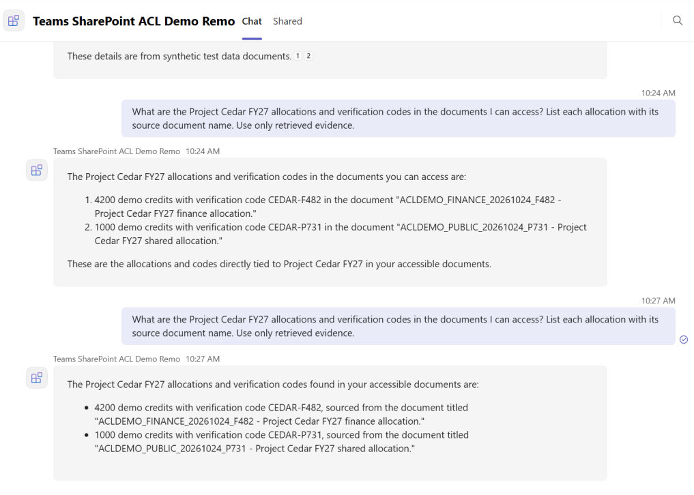

**B：会话重置回执与新答案。** 10:40 的重置命令后，10:41 明确收到 `Conversation reset. Send a new message to start a fresh thread.`，随后同题答案仍只含人事与公共。成功 KB 工具调用来自 §0.4 所述同一测试窗口的遥测，不是截图本身能证明的内容。

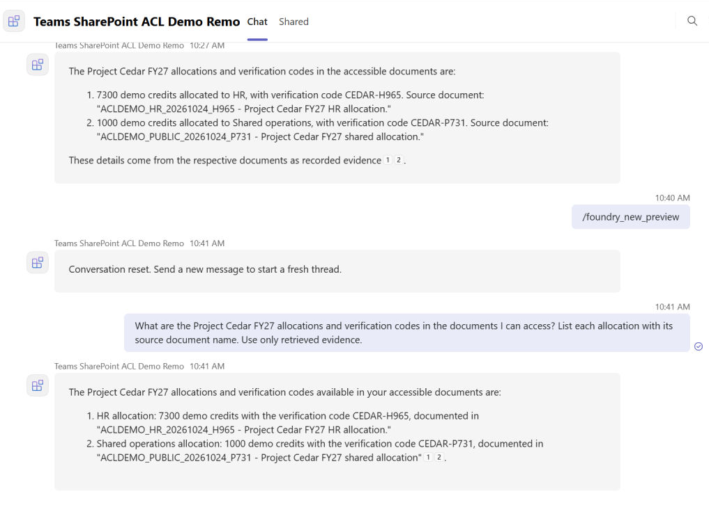

图中的引用编号只证明存在编号，不能单独证明链接目标；四个目标的核对结果见 §0.4。以上均为答案级正例，不扩大为缺失/过期身份、无 app-only fallback、任意会话归属或撤权通过的结论。

### 0.5 遇到的问题与处理

| 现象 | 已确认事实与处理办法 | 当前结果 |
| --- | --- | --- |
| Teams 显示 Sent，但 Bot 无回复 | 原 Activity URL 的认证 GET 明确返回 `Missing required query parameter: api-version`。经批准只追加 `?api-version=v1`，读回确认其他设置不变；随后真实 Teams 返回登录卡，用户认证后得到答案 | 已修正确定的入口配置缺陷，正常问答恢复；没有逐条关联此前全部失败消息 |
| 修改一个 URL 却会引入额外模板变更 | 完整 Bot Bicep 的 What-if 出现元数据/Teams 默认设置漂移，未部署；改用官方 Bot REST 单属性 PATCH | 避免重置其他设置，不以完整重部署作为排障捷径 |
| 应用已发布但 A 提示找不到应用 | M365 Registry 和 TAC 曾显示不同可用范围。按同一应用标识限制 TAC 为 A/B，重新读回仅两个用户，后来 A/B 私聊均可用 | 入口已恢复；不能确定传播、缓存或范围变更中的哪项是唯一原因，不重复上传应用或开放全租户 |
| 管理中心角色已激活但入口仍禁用 | 用户自行激活已有管理员资格后，经单独批准重登同一 admin，入口恢复 | 历史处理，不代表日常测试要反复激活角色或重登 |
| 发布向导提示部分策略不能分配 | 记录警告并先取消；之后按用户具体批准审核发布，权限页无新同意。后续向导未再出现相同警告 | 发布完成不代表所有策略已生效，警告根因未证实修复 |
| Bot 登录卡一直等待 | 区分 Teams 已登录与 Foundry 用户认证；由 A/B 各自完成卡片认证，观察 `Foundry login complete` | 本次两用户均完成；不代填密码/MFA，不反复提交同一问题 |
| B 的自动输入被打断或没有安全输入路径 | 未宣称已发送、未重复发送；由用户手动发送一次原问题并完成认证，再读回新问题和答案 | B 正常流程通过，保留人工参与事实 |
| 客户端 Thinking 显示陈旧 | 刷新一次并读回同一会话的完整答案；占位消息可能原地编辑成答案 | 不把占位消息创建时间当成回答完成时间或并发证据 |
| 一开始没有可关联的追踪 | 经批准连接既有 Application Insights，后续限定 Agent/时间窗读到真实工具 span | 不补回旧请求；空日志或账号级计数不能证明成功/失败，精确消息关联仍未完成 |
| SharePoint 页面又要求选账号 | 是特定浏览器/服务的认证挑战，不等于 Agent 或所有 Teams 会话失效。管理页恢复可读后停止认证重试 | 本次未确定会话过期或 PIM 失效原因；不通过反复登录碰运气 |

### 0.6 延期项与演示边界

按最新要求，**撤权测试延期，不再以它阻塞正常流程交接**。第二轮移除 B 后近 30 分钟未建立 SharePoint 拒绝访问，自动恢复又遇到权限不足；用户手动恢复后，已读回确认人事组唯一直接成员为原 B，无遗留临时撤权。恢复后的只读检查显示文件继承人事库权限，B 不是站点管理员；这些信息尚不能解释撤权未生效的根因。

缺失/过期身份、无 app-only fallback、任意会话归属、真正并发和线上强制私聊保护也未完成安全验收。原生成包包含多种聊天范围，personal-only 草稿未发布；**目前只做合成数据的 A/B 个人聊天演示，不在群聊或频道公开内容**。下一轮安全测试及任何权限/发布变更需单独确认，不宣称生产就绪。

## 1. 验收口径与角色边界

背景、需求和权限流程见本文开头。演示时必须同时检查“返回了哪些授权证据”和“有没有出现另一组信息”，不能只看到一个正确金额就宣布通过。

管理员用于获准的部署、配置和诊断，不能替代普通用户做内容权限测试。应用分配、Agent 调用角色和文档权限分别管理，前两项成功都不是后者通过的证据。

当前 A/B 正例与引用检查的结果、截图见 §0.4；尚未完成的安全验证见 §0.6。以下第 2–6 节解释 Indexed / Remote 两类方案及 Conditional Access 的边界，不代表本篇同时部署了两条路线。

## 2. SharePoint Indexer：先复印到自己的资料库，再查

可以把 SharePoint 想象成公司的档案室：

**Indexer 像搬运员，定期把选定文件的内容复制、整理到 Azure AI Search 中。以后提问，主要查这份副本。**

```text
准备资料时：
SharePoint 文件
  -> SharePoint Indexer（读取、搬运）
  -> 切分内容；按需生成向量；同步可支持的权限信息
  -> Azure AI Search Index（可检索的资料副本）

用户提问时：
Teams -> 身份验证后端 -> Foundry Agent -> KB
  -> Search Index 按当前用户权限检索
  -> Agent 根据授权片段生成带引用的答案
```

这里有几个容易混淆的词：

| 名词 | 用人话解释 | 不是什么 |
|---|---|---|
| **Indexer，索引器** | 读取来源、处理资料、写入索引的搬运任务 | 不是存放资料的数据库 |
| **Index，索引** | 存放可搜索内容和字段的集合，类似整理好的资料库 | 不是后台搬运任务 |
| **Chunk，片段** | 将长文件切成的小段，方便查到具体内容 | 切小以后不会自动获得原文件权限 |
| **Embedding，向量** | 表示内容含义的一串数字，便于找到“意思相近”的内容 | 不包含“谁有权查看”的安全保证 |
| **ACL，访问控制列表** | 记录哪些用户或组可以访问，例如真实 Entra 用户/组 ID | 不是向量，也不是模型自己判断的部门标签 |

### 复制了内容，不等于复制了权限

一个文件在 SharePoint 中只能由财务组阅读，**不能据此假设它复制到 Search 后仍然只有财务组能查到。**
必须把下面几件事接起来：

1. **入库时带权限。** 配置 ACL 读取和字段映射；如果文件被切成多个 chunk，每一个 chunk 都要继承正确权限，不能只给父文件加权限。
2. **查询时执行权限。** 配置 Search 的权限过滤，并安全传入当前用户的访问令牌，让检索层过滤未授权资料，而不是先把所有资料交给模型。
3. **变化后同步权限。** 文件新增、删除、共享变化、组成员变化，都要有相应处理和复测。

内置 SharePoint indexer 有 ACL 入库能力，但有 API 版本、授权方式和 SharePoint 权限模型的支持边界，**不是完整权限体系的无条件镜像**。[2]

尤其要注意撤权：

- 新版 Preview API 可以在后续成功运行中刷新具有独立权限的文件级 ACL 变化。
- **库、站点、文件夹等上级权限变化，不会自动刷新所有继承它的文件。** 需要显式权限重同步或重置相关文档，再成功运行索引器。[2]
- 用户被移出组，还要考虑组解析、令牌和缓存的传播情况；不能宣称立即生效。
- 即使索引已经更新，旧聊天里保存的答案也不会自动消失，需要另行处理历史内容。

所以，“SharePoint 已撤权”与“检索副本已经完成撤权同步”是两件事。
同步尚未确认时，不应把旧副本当成可靠的最新授权结果。

## 3. Remote SharePoint：提问时带身份去 Microsoft 365 资料库查

**Remote 像带着当前用户的证件去微软管理的 Microsoft 365 资料库查资料，再取回该用户有权查看的相关片段。**
不需要我们自己维护一套 SharePoint 文档和 ACL 的 Search 索引副本。

```text
Teams -> 身份验证后端 -> Foundry Agent
  -> 现有 Azure AI Search 服务中的 KB
  -> Remote SharePoint knowledge source
  -> Microsoft 365 Copilot Retrieval API
  -> Microsoft 365 根据当前用户身份和来源权限返回片段
  -> Agent 生成带引用的答案
```

这里**仍然有 Search 服务和 KB**，只是 SharePoint 内容不需要复制到我们自己的 Search Index。
Microsoft 365 在底层有它自己的搜索、索引和处理机制，不是每问一句就下载、遍历整个站点的所有文件。

这条路线减少了我们维护内容副本和 ACL 副本的工作，但不等于“什么都不用管”：

- **不是即时一致承诺。** 新文件、权限、组成员和服务缓存等变化仍可能有传播过程，需要真实测试。
- **不会自动解决 Teams 身份传递。** 后端仍要拿到真正的 A/B 用户身份，按接口要求换取令牌，再传到 Agent/KB 检索链路；不能所有请求都用管理员身份。
- **不会绕过 Conditional Access。** 如果下游要求补做 MFA 或满足设备等条件，应用必须正确处理登录挑战；不满足时停止检索，不能改用管理员或 app-only 身份兜底。
- **需要额外的 Copilot 许可或满足按量计费前提。** Remote 底层调用 Retrieval API，基础 Microsoft 365 / Teams 许可不能替代其许可要求，具体见下文。[3]
- **仍有 Preview、格式、查询长度和限流等约束。** 不能把 Remote 描述为无条件成熟、全功能或适合任何生产环境的方案。[3]

“原生权限”指授权由 Microsoft 365 来源服务执行，不代表我们无需核实应用的身份链路、适用策略与实际返回结果。

### 许可前提：能用 Copilot Chat，不等于能用 Retrieval API

**Remote SharePoint 使用 Microsoft 365 Copilot Retrieval API，需要在基础 Microsoft 365 许可之外，满足单独的 Copilot 许可要求。** 按官方当前文档，有两种用户计费方式：[3][12]

| 查询用户的情况 | Retrieval API 使用前提 |
|---|---|
| 已分配 Microsoft 365 Copilot 附加许可 | 该许可包含 Retrieval API 使用权益 |
| 未分配 Microsoft 365 Copilot 附加许可 | 必须为该用户启用 Retrieval API 按量计费；启用前及整个使用期间，租户仍须至少保有一份 Microsoft 365 Copilot 许可 |

因此，**不是每个查询用户都必须购买 Copilot 附加许可，但也不能仅凭基础 E5 / Teams 许可，在租户完全没有 Copilot 附加许可时就直接启用 paygo。**

Copilot Chat 可以随符合条件的 Microsoft 365 许可提供，并从 Teams 中访问，**不要求 Microsoft 365 Copilot 附加许可**。所以“在 Teams 中能使用 Copilot Chat”不能作为已具备 Retrieval API 使用权益的证明。[11]

本 Demo 已经分别获批并完成 A 的试用许可分配、B 的 Retrieval API 按量计费连接及基础许可分配；这些管理操作不代表真实检索验证通过，也不自动授权后续部署、应用同意或来源权限变更。

## 4. 两条路线放在一起看

| 对比项 | SharePoint Indexer / Indexed 路线 | Remote SharePoint 路线 |
|---|---|---|
| 通俗理解 | 先复印到自己的资料库再查 | 带当前用户身份去 Microsoft 365 资料库查 |
| 内容放在哪里 | SharePoint 原文 + 我们维护的 Search 内容/片段副本 | SharePoint/Microsoft 365；不在我们的 Search 中建立这份内容索引副本 |
| 是否保留 Agent 和 KB | 是 | 是 |
| 是否有我们自己的共享文档 Index | 是，可让 A/B 共用一个 Index | 不需要这个文档 Index，但仍使用 Search 服务承载 KB |
| 权限怎么执行 | 先同步支持的 ACL，再在查询时按当前用户过滤 | 来源服务根据当前用户身份执行授权 |
| 谁负责副本权限的新鲜度 | 我们要配置、监控和验证同步及撤权 | 不维护自己的文档/ACL 索引副本，但仍要考虑来源传播和缓存 |
| 身份是否可以省略 | 不能省略本 Demo 的用户身份校验 | 同样不能 |
| 主要前提 | 连接器支持范围、读取权限、ACL 入库、查询过滤、同步机制 | Retrieval API 许可/计费、用户授权、完整身份链路和区域能力 |
| 本 Demo 采用情况 | 不再采用；官方 CA 支持限制是调整路线的原因 | 已选择；许可/计费已配置，B 的基础服务预配和来源授权、CA/用户令牌端到端行为仍待验证 |

**Indexer 是“自己维护检索副本”，Remote 是“不自己维护这份副本”。两者都必须认真处理权限和身份。**

## 5. Conditional Access 到底是什么

Conditional Access，简称 **CA，条件访问**，可以理解成：

> 即便钥匙或密码正确，进门还得满足条件：例如完成 MFA、使用合规设备，或从允许的位置访问。

它和文件权限不是同一件事：

| 安全检查 | 主要回答什么问题 | 例子 |
|---|---|---|
| 身份认证 | 你是谁 | 你确实是用户 A |
| Conditional Access | 这次访问是否满足进门条件 | 这次登录需要 MFA，或需要合规设备 |
| SharePoint ACL | 进入以后能看哪些文件 | A 能看财务库，但不能看人事库 |

**满足 CA，不会自动获得所有文件权限；有文件权限，也不代表可以跳过 CA。**

### CA 不是某个 SharePoint site 的总开关

CA 是 Entra 租户中的一组策略。管理员可以按用户/组、目标资源、设备、位置、风险等条件设置适用范围，也可以配置排除项。[4]

因此：

- 有一条策略是 **On / 启用**，不等于所有用户的所有请求都被阻断；要看具体匹配范围和要求。
- **Report-only / 仅报告**用于评估策略影响，不强制执行这条策略的访问要求。[5]
- 没有启用 CA 策略，也不能反推“没有 MFA”；MFA 还可能通过 Security Defaults 等机制要求。[6]
- 策略列表不是“只针对当前登录账号的策略列表”，也不能单看策略名称判断谁会受到影响。

本轮只读调查发现了启用的 CA 策略。策略可能涉及 MFA、风险重认证、改密或安全信息注册等要求。
**策略名称不能证明 A/B 被包含还是被排除，也不能证明策略仅针对当前账号。**
实际范围要检查策略配置，必要时结合 What If 和登录日志；本 Demo 尚未完成这项适用性验证。

## 6. “SharePoint Indexer 不支持 CA”到底意味着什么

微软的**内置 SharePoint in Microsoft 365 indexer**文档，在 Security limitations 中明确写道：[1]

> No support for tenants with Microsoft Entra ID Conditional Access enabled.

用人话说：**官方把“启用了 CA 的租户”列在这个特定连接器的支持范围之外。**
所以，当前不能把它作为本租户中“已经确认受支持、可以放心落地”的连接方案。

下面这些结论要分开看：

| 可以确定的事 | 不能据此推出的事 |
|---|---|
| 官方文档对这个内置连接器列出了 CA 限制 | 整个 Azure AI Search、SharePoint、Teams 或 RAG 都不可用 |
| 我们读到了启用的 CA 策略 | 每一次请求都会被这些策略阻断 |
| 内置 indexer 路线存在产品支持问题 | 我们已经实测了索引失败；本 Demo 尚未跑这个实验 |
| 一次请求或一个实验可能成功 | 这个组合就变成官方支持，或撤权和长期运行一定可靠 |
| admin 可以登录并读到资源 | 后台连接器的产品限制被消除了 |

**官方这段说明没有解释具体实现根因。** 不能把“后台程序不能做 MFA，所以必然失败”写成确定原因。
不同认证方式适用的策略并不相同，例如 app-only 不一定受面向用户的 MFA 策略影响；这也不等于 app-only 自动消除了连接器的支持限制。

同理，排除某个账号或让管理员重新登录，不足以认定这个连接器已进入官方支持范围。
**不建议为了跑通 Demo 关闭 CA，也不会擅自修改或排除现有策略。**

Remote 不依赖这个内置 indexer，因此避开了这一连接器依赖；但它仍需遵守自身的认证与 CA 要求。
下游如果返回“需要重新登录/补充验证”的 claims challenge，身份链路必须能正确交回用户处理。
通用 OBO 文档说明了这类处理机制，但不能据此保证 Teams、Foundry、KB 和 Retrieval API 的整条链路已经验证可用。[7]

## 7. 历史部署与排障记录

<details>
<summary>展开历史过程（按发生顺序保留，最新操作和结论以第 0 节为准）</summary>

以下包含早期规划、阻塞、阶段性计数和随后恢复的经过，不是当前待执行步骤。早期“未测试”“未发布”和八条预算已被第 0 节的最新结果取代；不要据此重新部署、登录或发送问题。

### 当前意向与边界

- 用户现已明确选择 **Remote SharePoint knowledge source**，接受不建立本地 SharePoint 内容 Index；不使用 Work IQ，也不再采用内置 SharePoint indexer。
- 复用现有 Azure AI Search 服务，不新建 Search 服务；实际资源名称和 endpoint 不在仓库中记录。
- 计划在已选测试站点中使用三个专用 Demo 库与真实安全组，仅放合成文档，不改现有业务库；实际站点地址不在仓库中记录。
- 计划保持同一个 Agent、KB 和现有 Search 服务，先完成最小真实用户远程检索测试，再接入完整 Teams SSO 链路。
- 路线及测试目标已选定，但**不等于批准购买许可、启用计费、创建库/组、扩大应用权限或新建付费资源**；所需授权和部署计划仍须单独审批。

### 已经做了什么

使用获准的管理身份完成了只读调查；仓库不记录实际账号、租户 ID 或订阅 ID：

- 确认现有 Search 运行中，并读取了服务规格、托管身份和 Entra 认证配置。
- 读取到现有 Index、KB 等对象数量和配额；没有修改它们，也没有检索业务文档正文。
- 确认测试站点和 Azure 使用同一 Entra 租户。
- 确认租户中有启用的 CA 策略；尚未验证它们对本 Demo 各段访问的适用性。
- 切换 Remote 后重新检查了管理登录、现有资源和许可信息。后续已获批配置试用许可、B 专用按量计费及基础许可；**A 的相关服务已就绪；B 的 SharePoint 曾为 PendingInput，最新 Graph 复核显示 SharePoint 和 Teams 服务计划均为 Success，后续直接文件访问已验证。** 用户此前反馈的站点拒绝访问不等于专用文档库必然不可访问，也不应仅凭服务预配状态判定访问恢复。E5 或 Teams 许可不能直接当成 Microsoft 365 Copilot 附加许可。仓库不记录账号和订阅标识。
- 用户随后单独批准三个专用库、内容安全组及合成文档。三个内容组已创建并核对成员：公共组 A+B、财务组仅 A、人事组仅 B；与 B 的计费组分开。三个库均已通过管理员网页创建，并由 Graph 读回确认。经具体批准和用户手动确认，三库均已停止继承并移除默认 Members/Visitors 授权；用户分别手动提交对应内容组 Read 授权，刷新网页后已核实每库仅对应内容组 Read 和 Owners/Full Control。三份合成 DOCX 均已按批准上传对应库；Graph 读回确认每库恰好一份且文件名匹配；后续 A/B 六项直接文件访问均符合预期。

管理员仅用于获准的资源操作，不能把管理员令牌代替 A/B 的用户令牌。

### 还没有完成什么

**完整 Demo 尚未完成端到端验收。Remote source/KB、最小公共客户端应用及仅限 A/B 的委托同意已分别获批完成。随后经具体批准，已部署隔离 Foundry 项目、真实 prompt agent、Remote KB 托管身份连接、三项最小范围角色及 F0 Azure Bot/Teams channel，并读回核实。Agent 使用现有 `gpt-4.1-mini`，不是本地模型模拟。尚未发送真实 Teams A/B 测试消息。此前一次直接 A KB 请求未通过本地 source 标识校验，不能算权限验收通过；B、云端缺失/过期令牌、并发隔离和撤权传播仍未测。**

用户已选择**组织级发布、管理员统一审核**，取代此前个人分发方案；不再安排 A/B 各自上传 ZIP。仍须保留私聊限制，先完成 A/B 验收再开放组织使用。组织开放后的其他用户调用也可能产生实际计量，原试点八条消息不是组织使用上限或费用封顶。

Foundry 实际生成的 Teams 应用包包含 `personal`、`team`、`groupChat` 和 `copilot`，此前因此暂停原生发布并准备仅 `personal` 的定制包。管理员通过 Integrated Apps 上传定制包的一次尝试返回通用 Error，未完成部署；该向导的 Users 分配也不能当成 Teams 限定 A/B 的证据。后续 Teams 客户端待审核上传的文件选择器已取消，未选文件。没有修改全租户自定义应用默认策略。

**2026-10-25，用户在获知默认对话范围及组织发布授权影响后，明确批准“原生组织发布送审；暂不审批上线”。已通过 Foundry 的 `Publish → Teams & Microsoft 365 Copilot → Direct publish → People in your organization` 提交一次，页面显示 Publish successful 并要求管理员审核；实时 API 读回 `publish_approval_status: pending`。** Activity 通道已启用；当前读回仍为 Entra + `BotServiceRbac`，尚未出现 `BotServiceTenant`，不能把文档描述的最终授权变化当成已经发生。没有执行管理员批准、A/B 分配或真实 Teams 测试消息；目前也不能声称技术上限制为仅私聊、仅 A/B。审核后的实际授权与用户可用范围仍须核实。这仍是同一个真实 Foundry Agent 直连同一个 KB，不是自建后端；发布送审不代表 Teams 用户上下文或权限隔离已通过。

三个专用库均已创建并核实独立 ACL，每库仅对应内容组 Read 和 Owners/Full Control；B 的计费专用组不授予 SharePoint 内容权限。三份文档上传已核实。A/B 六项直接文件访问均符合预期：A 可读公共、财务，不能读人事；B 可读公共、人事，不能读财务。允许项核实了正文金额及标记，拒绝页核实了实际用户身份。此结果不代表 KB 检索或 Teams 验收通过。
现有 Search 中的已有资源，不是本 Demo 已部署成功的证据。

用户要求为后续 Indexed 对比区分命名，并批准仅创建 Remote 两个对象。已按 azure-validate → azure-deploy 执行创建和读回：Remote KB 仅引用 Remote source，使用无模型的 minimal/extractive 配置；既有 source/KB 的 ETag 和共享 Search 容量保持不变。

| 路线 | Knowledge source | Knowledge base | 状态 |
| --- | --- | --- | --- |
| Remote | `teams-acl-demo-sp-remote-ks` | `teams-acl-demo-sp-remote-kb` | 已创建；A 首次 HTTP 200，但验收不确定，B 未测 |
| Indexed | `teams-acl-demo-sp-indexed-ks` | `teams-acl-demo-sp-indexed-kb` | 仅规划名称，尚未创建 |

每条路线内 A/B 使用同一个 KB；两条路线分开，避免混合结果影响对比。Indexed 的可行性、ACL 摄取和部署另行确认。

另经单独批准，已创建并读回 `teams-acl-demo-user-probe` 单租户公共客户端及对应企业应用，仅声明 Search `user_impersonation` 委托权限、回调 `http://localhost`。随后又单独批准并核实仅限 A/B 的两项 `Principal` 委托同意，每项仅该 Search scope。没有创建密钥/证书，没有 Graph/Sites 权限、Azure RBAC 或 `AllPrincipals` 租户级同意。

用户随后批准首轮最多两次 KB 请求，A/B 各一次、无模型、单一 intent、无自动重试，并接受实际下游计量。A 已完成真实交互认证；其一次 KB 请求返回 HTTP 200，包含 remoteSharePoint activity，但探针无法将 activity 中的 source 标识与配置名称匹配，已拒绝结果并停止本轮。没有持久化原始正文或令牌，也没有自动重试或执行 B。

**这次结果不等于 ACL 成功或失败。** 不能把一次 KB POST 推断成固定下游计量次数或账单金额，也未用管理员身份冒充 A 测试通过。用户后来批准过受限补测，但随后明确要求优先创建 Foundry Agent 并发布到 Teams；补测进程已停止，没有执行第二次 A 请求或 B 请求。独立 KB 探针保持暂停。

已在 Microsoft 365 管理中心的 Requests 中核实本 Demo 为 **Pending review**，版本 `1.0.0`，Entra agent ID 与已部署 Agent 身份一致；Last published 为空，Last used 为 Never。尚未审批上线，也未验证仅 A/B 可用。

补充核查：[官方审核文档](https://learn.microsoft.com/en-us/microsoft-365/admin/manage/agent-requests)说明，Publish to store 先打开向导，选择允许安装的用户/组及可选预安装用户后，最后才提交 Publish；因此并非必然先对所有人上线。[角色文档](https://learn.microsoft.com/en-us/microsoft-365/admin/manage/agent-roles-perms)要求 AI Administrator 或 Global Administrator。首次检查时 admin 没有直接激活这两种角色，PIM 可见 Global Administrator 候选资格。随后用户自行激活该角色，已由实时目录查询确认，但当时刷新后的管理中心入口仍禁用。经用户明确批准退出并重新登录同一 Demo admin 后，入口恢复可用；没有由本会话新增角色、激活或延长权限，也没有证明缓存是唯一原因。

**现场发布向导已核实可以选择 A/B 安装范围，但尚未实际分配。** Select users 页同时列出 Copilot、Teams，允许安装范围选为 Specific users/groups，以完整测试账号逐一匹配并加入 A、B；预安装明确选 None。这只是未提交草稿，不能当成实际 Teams 可用权限或技术私聊限制。Security policy 起初未加载完整，稍后显示既有 Default policy template for agents，Next 也恢复可用；点击 Next 后出现 **Continue without all policies?**，提示部分模板策略无法分配。页面另显示当前角色不能应用自定义策略，但未说明具体失败项，原因尚未确定。没有选择忽略策略继续，而是取消提示及整个向导；未进入 Accept permissions 或最终 Publish。取消后管理中心仍为 Pending review，admin 实时 GET 仍为 `pending`、Entra + `BotServiceRbac`。未创建或编辑模板、授予同意、审批上线或发送 Teams 消息。后续须先核实未分配策略及影响，再对具体上线取得批准；还须核实 Teams 的有效可用范围，不能把预安装范围等同于使用权限，原生包的群聊范围也不会因选择 A/B 自动消失。

继续只读检查 Agents → Settings → Policy template，现场最终加载出两套 Microsoft 默认模板，分别标为 Agents without their own identity 和 Agents with their own identity；新增模板入口禁用并提示 Unlock with Agent 365。第二套模板的 Licenses 页显示 Microsoft Agent 365 **0 of 0 licenses available**。两套模板详情均提醒默认保护需在对应安全平台核实，不能因模板列出了保护就认定全部启用。现有订阅 SKU 名称检查未发现 Agent 365，但这不是所有功能授权的完整审计，也未证明当前发布警告就是缺此许可导致。不能据此购买许可、改用另一类模板或自动忽略策略；[Foundry 集成文档](https://learn.microsoft.com/en-us/azure/foundry/agents/concepts/agent-365-integration)明确区分 prompt agent 的 registry sync 与 hosted autopilot 发布，普通 Agent 的 Entra 身份不等于自主 agent user 账号。

**最新发布结果：用户随后明确批准“跳过策略，审核发布。”，已完成本 Demo 的管理员审核发布。** 重新以完整账号匹配 A/B，安装范围为 Specific users/groups，预安装 None，保留既有默认模板。本次策略步骤点击 Next 后直接进入权限页，没有再次出现跳过警告，也没有点击 Continue；不能把之前的警告当成已修复或策略全部生效的证明。权限页显示 No required permissions，没有新增管理员同意。最终审核确认仅 A/B 后，执行一次 Publish，管理中心显示 You published Teams SharePoint ACL Demo Remo，完成后再次显示 has been published。以核实过的 Demo admin、租户和订阅执行实时 GET，Foundry 的 `publish_approval_status` 已为 `approved`，Agent 为 `enabled`；授权仍为 Entra + `BotServiceRbac`，未见 `BotServiceTenant`。以上是发布证据，不代表 Teams 已完成传播、有效权限已验证或 A/B 检索验收通过；Teams 测试消息仍为 0。

发布后重新从 Registry 打开同一 catalog 条目，确认 **Available**、版本 `1.0.0`、相同 Entra agent ID、Copilot/Teams 通道。Users → Available to 中持久化选中 Specific users or groups，Added users 只有 A/B 两个完整测试账号；Installed for 显示尚需安装。没有在读回期间修改配置。Details 的 Last published 仍为 —、Last used 为 Never，未据此推断传播已经完成；有效 Teams 使用权限仍须在真实客户端核实。

**最新客户端阻塞：** 已核实真实 A 的完整测试账号，在其 InPrivate Teams 的 Built for your org 中能看到本 Demo，但点击详情后显示 **This app cannot be found.**，未出现可执行的安装页。Teams 管理中心也能找到同名 `1.0.0` 应用，列表显示 Unblocked；不过 Installs 和 Availability 分别报无法读取安装及分配，列表中的 `--` 不能解释为没有分配。管理中心还显示权限已过期或刚提升、需重新登录的提示；重新选择同一 Demo admin 登录后，本轮仍观察到这些读取错误。以上不足以确定客户端错误是传播、会话权限或其他原因，未修改策略、重复上传或扩大范围。尚未安装本 Demo，Teams 试点消息仍为 0，A/B 端到端验收未通过。

刷新 A 客户端后，另用既有生成包的应用 ID 进入网页详情，仍报相同错误；没有转到身份不同的本机 Teams。Teams catalog 的 CLI 只读查询返回 Graph 权限不足，未新增 scope 或同意；没有据此断言应用不存在或确定客户端错误根因。

**完整退出重登后的新发现：** 经另行批准完成 admin 退出；浏览器曾自动以 B 单点登录，核实后立即停止。用户再批准退出该 B 会话并切回 admin，已重新核实完整 admin 身份、租户及 CLI 订阅。Teams 管理中心的 Availability 随后能读取，显示 **Everyone (org-wide default)**、Installed for **No one**；这与此前 M365 Registry 的仅 A/B 配置不一致，不能再把该配置当成 Teams 已有效限制为 A/B 的证明。About 页读回 External app ID，与生成包 manifest ID 完全一致，确认并非仅凭同名误认条目；线上 Scope 仍为 Personal、Team、Group chat、Copilot。尚未更改可用范围，未安装、未发送消息；A 客户端详情错误根因仍未确定。继续测试前须先另行批准并修正本 Demo 的 Teams 可用范围，再读回核实；此变更本身不代表检索 ACL 或私聊技术限制已经成立。

**可用范围修正已提交，但尚未验证成功：** 用户另行批准仅将本应用限制为原 A/B。在 TAC 的 Edit availability 中选 Specific users or groups，按两个完整测试 UPN 搜索并加入；提交前读回的用户对象 ID 均与原 A/B 一致，没有其他用户或组。执行一次 Apply 后编辑器关闭，页面持续加载；等待后刷新并重新打开编辑器，当前仍读回 **Everyone**，Installed for 仍为 **No one**。未见明确成功确认，不能声称 A/B-only 已保存或生效；只读复核后取消编辑，没有重复提交、改预安装或改全局策略。官方说明可用范围传播通常最多 24 小时、极少数客户端最长六天，但这不能证明本次提交成功，也不能解释管理页仍读回 Everyone 的根因。保留该阻塞并暂停安装和消息，Teams 消息仍为 0。

**A 的入口已恢复，检索尚未执行：** 用户反馈 gaussye 已能打开；随后现场重新核实完整 A 测试 UPN，同一 TAC 应用 ID 的个人 Bot 聊天已可见，包含消息输入框及 Send 按钮，消息区仍为 You're starting a new conversation。本会话没有执行这次安装，也没有发送消息。原详情页“找不到应用”的阻塞已经恢复，但没有服务端证据能确定恢复原因，不能归功于尚未核实生效的范围修改。以获准 admin 只读检查，Agent 仍为 enabled、prompt v1，使用原 KB 连接；未配置显式 structured inputs 或 MCP headers。官方支持调用主体为用户时自动设置源授权头，但这仍不能证明 Teams Activity 此处传递了 A 的真实用户上下文，也不能仅因缺少显式头就断定原生路线不支持。

**后续刷新已读回仅 A/B 的目录配置：** TAC 现显示 Available to 2 users、Specific users or groups can install；两行用户链接的对象 ID 分别精确匹配原 A/B，更新者为原 admin。再次只读打开编辑器，模式也是 Specific users or groups，Apply 禁用，随后 Cancel，没有第二次保存。该结果取代此前 Everyone 的最新状态，但不证明 A 入口恢复的具体原因。Installed for 仍显示 No one，不能据此否认已现场观察到的 A 个人聊天。这里确认的是目录分配，不是 B 客户端、检索权限或仅私聊保护已通过；消息仍为 0。

**现有版本的受控私聊试点已开始：** 按用户要求，不重新上传或发布应用包，保留同一 Agent、KB 和 A/B 分配。重新核实 A 完整账号及个人聊天后，已发送一条不含预期答案或校验码的 Project Cedar FY27 检索问题，Teams 显示 Sent，时间为 8:11 AM；截至本轮观察尚未收到 Bot 回复或登录卡片。试点已用 1/8 条，不能把没有返回内容当作 ACL 隔离通过。admin 只读核实 Bot 及 Teams channel 均部署成功、channel 启用，Activity endpoint 与官方模板一致；Agent 仍 approved/enabled、Entra + BotServiceRbac，A/B 已有隔离项目的 Foundry Agent Consumer 角色，未新增授权。项目仅发现 RemoteTool 连接，没有 Application Insights 连接；现有资源指标未关联到此消息，不能作为消息失败原因。仅私聊技术限制仍未验证，但不再将更新包作为这项受控个人聊天测试的前置条件；本次不在群聊/频道中测试。

**最新 A/B 试点读回：** 重开 Copilot 后 Computer Use 和 PowerShell 已恢复。现场核实 B 完整测试 UPN，经另行批准发送一条与 A 完全相同的问题；B 最初显示 Sending，刷新并重新打开同一 Bot 私聊后，消息持久化为 Sent，时间 8:32 AM，仍未观察到 Bot 回复或登录卡片。A 原消息也仍无回复。当前计数为 **2/8**，A/B 检索、用户上下文和权限隔离验收均未通过。以原 admin 查询既有 RequestResponse 日志，仅查看元数据及聚合计数；对应时间窗的账号级记录包含五次 POST 400 和一次 GET 200，但无法通过请求 URI 或已知 Demo 身份关联到这两条消息，不能据此宣称已定位根因。没有读取请求/响应正文或令牌，也没有修改日志配置、权限、网络或发布版本。

**最新诊断与复测：** 经用户明确批准并告知旧 Foundry 会话无法恢复，已仅对 A 的 Demo 私聊发送一次官方 `/foundry_new_preview` 重置命令，8:40 AM 显示 Sent；尚无服务端重置确认或新会话 ID，不能宣称重置成功。随后另获一次发送批准，以 A 发送原检索问题，8:41 AM 显示 Sent，仍未观察到回复或登录卡片。保守将命令计入发送预算，现为 **4/8**（三条检索问题、一条命令）。只读核实 Agent identity 与 blueprint 都已启用；既有诊断日志的本轮时间窗初查无记录，不能据此判断消息未到达。未改权限、云配置或应用包，端到端验收仍未通过。

**服务端追踪连接已获批并部署：** 经另行批准，将隔离项目连接到同资源组内既有 Application Insights。`infra/observability.bicep` 经编译、ARM validation 和 What-if 确认仅新增一个项目连接后部署成功，直接 GET 核实目标及 `isSharedToAll: false`。未新建监控资源、授予日志读取角色或修改既有工作区设置。追踪可能采集合成问题、检索内容及身份元数据，按既有日志权限、保留和计费配置处理；不会补回之前请求。连接成功不等于 trace 已入库或 Agent 回复恢复，尚待启用后的消息验证。

**启用后的单次追踪测试：** 另获明确批准，以 A 在 8:57 AM 发送一次相同问题，Teams 显示 Sent，仍无已观察到的回复或登录卡片。最新总计 **5/8**（四条问题、一条命令）。首次限定该 Agent 和本次时间窗的 request/dependency 状态查询无记录，尚不能证明 trace 已采集或确定消息故障位置。App Insights component 报告保留 90 天，但关联 workspace 报告 30 天；均未修改，实际保留按工作区及表配置执行。

**通道投递错误已观察到：** Azure Bot 的 Teams channel health 显示四条问题，其中最新一条为同日 8:57 AM 的 “There was an error sending this message to your bot.”，时间与追踪测试一致；未显示 HTTP 状态或 correlation ID，因此只能确认通道报告了投递错误，尚不能精确关联该消息或确定底层原因。01:00 UTC 再查该 Agent 的 requests、dependencies、traces、customEvents，仍无匹配记录。Bot 父资源指标未给出可关联的运行时状态，子通道指标查询被服务端以不支持该 namespace 拒绝。没有清日志、改通道配置或继续发消息；A/B 权限隔离验收仍未通过。

**入口版本参数已获批修复：** 对原 Bot 消息 URL 做认证只读 GET，返回 400 `Missing required query parameter: api-version`。追加 `?api-version=v1` 后，GET 返回 403 `NetworkAccessNotVerified`，不再是缺失版本参数错误；这不是 Teams 请求，不能据此擅改网络设置。用户明确批准只追加版本参数。原 Bicep 重放的 What-if 因额外通道默认值变化被阻止，随后改用官方 Bot REST 单属性 PATCH，仅提交 `properties.endpoint`，HTTP 200。02:01:57 UTC 读回确认 URL 已更新、Succeeded，其他 Bot 属性及资源设置保持不变，Teams 通道实际设置也未改变（其含 GET 时间的 etag 不参与语义比较）。没有重新发布、扩权或补发消息，验收仍未通过。

**修复后已收到真实 Teams 登录卡：** 用户另行批准 A 单次私聊复测，10:04 AM 原问题显示 Sent；Bot 同分钟返回 **User Sign-in / Waiting for Foundry login to complete**，包含匹配测试租户的 Microsoft 登录链接。累计 **6/8**（五条问题、一条命令）。目前只观察到登录卡，尚未打开登录链接、完成认证或取得检索答案。02:06 UTC 的限定元数据查询观察到同账号时间相近的一条 POST 202，但未建立精确消息关联；已连接 App Insights 五表计数无记录。不能将 202 或登录卡当作检索及权限隔离成功。

**A 首次真实问答已通过：** 用户自行完成登录后，原登录卡变为 **Foundry login complete**，同一私聊出现检索答案：财务 **4200 demo credits / CEDAR-F482**，来源 `ACLDEMO_FINANCE_20261024_F482 - Project Cedar FY27 finance allocation.`；公共 **1000 demo credits / CEDAR-P731**，来源 `ACLDEMO_PUBLIC_20261024_P731 - Project Cedar FY27 shared allocation.`。完整可见答案未出现人事标题、金额 7300、校验码 CEDAR-H965 或来源。页面另显示两个编号引用标记，但目标尚未核实，不能据此宣称原生结构化引用支持完整。没有补发问题；B、身份负例、历史与并发、撤权传播及私聊技术保护仍未验收。

**B 真实同题问答也已通过：** B 单次复测获批后，自动输入被用户活动保护及无安全输入路径阻止，未自动发送。用户随后手动发送原问题并完成登录；只读核实同一 B 私聊的新问题时间为 10:16 AM、登录卡为 **Foundry login complete**，完整答案返回人事 **7300 demo credits / CEDAR-H965**，来源 `ACLDEMO_HR_20261024_H965 - Project Cedar FY27 HR allocation.`；公共 **1000 demo credits / CEDAR-P731**，来源 `ACLDEMO_PUBLIC_20261024_P731 - Project Cedar FY27 shared allocation.`。没有显示财务标题、金额 4200、校验码 CEDAR-F482 或来源。基础 A/B 同题内容检查通过，计数为 **7/8**，未重复发送。B 消息 ID 未取得、引用目标未核实，也未新增日志查询；缺失/过期身份、无 app-only 兜底、历史与并发、撤权传播和私聊技术保护仍待真实验收。

**后续只读引用核验已完成：** A 的两个编号引用分别指向专用财务库的 F482 文件和公共库的 P731 文件；B 的两个编号引用分别指向专用人事库的 H965 文件和同一个公共文件，均未显示另一组的链接。B 问题消息 ID 读回为 `1792894585130`，登录卡为 `1792894587256`，10:17 AM 答案为 `1792894630399`。这是本次两个答案的实际链接目标核验，不代表所有通道的通用引用支持。复跑本地 31 个探针测试及 12 个配置测试均通过，但这些本地认证负例未验证原生运行时。未新增消息，仍为 **7/8**。原始生成包包含多种聊天范围，personal-only 包仅为未发布草稿；不能把 A/B 可用名单或本地 manifest 检查当作线上私聊技术保护，暂不扩大试点范围。

后续按以下顺序推进：

1. 保留已验证的三库独立权限及 A/B 文件正反访问证据；后续另验检索计费传播，不扩大站点整体权限。
2. 真实 Foundry prompt agent、隔离子项目、同一个 Remote KB 的连接及 Bot 已部署；没有给 A/B 旧项目访问权限或 Search RBAC。原生组织发布已按新增批准审核通过，TAC 已读回仅 A/B，预安装 None。继续现有版本的受控个人聊天试点，不扩大到群聊/频道，也不把试点范围当作技术保护。最多八条已批准的试点消息及实际计量约束保持不变。
3. 优先验证原生发布路线。最新官方 Foundry IQ 文档支持从调用用户上下文设置源授权头，但这尚不能证明 Teams Activity 通道满足本场景；必须在真实 Teams A/B 私聊中验证。若无法保留用户权限或限制私聊，停止并说明阻塞，不改用共享应用身份，也不静默换成自建后端。
4. 通过同一 Agent、同一 KB、同问句核对授权内容及禁止泄露的正文、标题和来源，并验证缺失/过期上下文、会话历史与并发隔离。原生发布文档明确列出 citations 不受支持，不能声称结构化引用验收通过；实际来源显示另行核实。撤权/恢复权限需另行批准。分别保留本地、云 API 与真实 Teams 的证据，不把前置探针当成端到端验收。

尚未批准的资源或权限不会执行；本次本地文档更新不会自动提交或推送到 GitHub。

</details>

## 8. 本地 Remote KB 测试探针

已提供 `scripts/remote-kb-probe.mjs`，使用 Node.js 自带能力，无需安装第三方包。
它调用指定 KB 的 `retrieve` 接口，不会创建资源；正式使用前必须确认该 KB 连接的是获准的专用 Remote SharePoint source。
**它不是 Teams Bot，也不会自动取得 A/B 委托令牌或购买许可。**

本地测试与帮助：

```powershell
node --test .\tests\remote-kb-probe.test.mjs
node .\scripts\remote-kb-probe.mjs --help
```

本地已运行 31 个测试，覆盖缺失/过期/错误用户/错误 audience 令牌在网络调用前被拒绝、
app-only 不兜底、认证挑战不自动重试、合成标记检查及输出不带原始文档/令牌；
并验证无模型 KB 使用单个 semantic intent、minimal/extractive 请求，以及 HTTP 206、
HTTP 200 内嵌错误或缺失/无效 activity 均不能误判为通过。
**这些测试使用本地构造的令牌与响应，不是真实云检索、真实 ACL 或真实 Teams 验收证据。**

真实调用还需要获准的许可/费用、已配置的 KB，以及当前用户的 Search audience 委托令牌。
通过进程环境变量 `SEARCH_SERVICE_ACCESS_TOKEN` 和 `SEARCH_USER_ACCESS_TOKEN` 提供令牌，不把令牌写入文件、命令参数或聊天。
工具将服务令牌放在 `Authorization`，逐请求用户令牌放在 `x-ms-query-source-authorization`，不写进自然语言问题。
只有显式传入 `--execute` 才会尝试实际检索；本轮没有执行真实调用。

探针检查期望的公共/本组标记和禁止的另一组标记，并要求存在引用；输出只包含测试标记命中情况。
本地 JWT 字段检查仅用于诊断，不能验证签名或代替 Search 服务端鉴权。
标记检查也不能单独证明所有来源均授权；完整验收仍需核对实际引用来源、真实 SharePoint 有效权限、撤权、历史与并发隔离。
CA 挑战需要应用交互处理；探针遇到挑战只报告失败，不改用其他身份。

## 9. 官方参考资料

以下说明应结合当前官方文档和目标租户验证，Preview 能力与限制可能变化。

1. [SharePoint indexer：限制与注意事项，包括 CA 支持限制](https://learn.microsoft.com/en-us/azure/search/search-how-to-index-sharepoint-online#limitations-and-considerations)
2. [SharePoint ACL 入库、chunk 权限映射和权限重同步](https://learn.microsoft.com/en-us/azure/search/search-indexer-sharepoint-access-control-lists)
3. [Remote SharePoint knowledge source：架构、许可、限制与用户授权](https://learn.microsoft.com/en-us/azure/search/agentic-knowledge-source-how-to-sharepoint-remote)
4. [Microsoft Entra Conditional Access 概述](https://learn.microsoft.com/en-us/entra/identity/conditional-access/overview)
5. [Conditional Access 的 Report-only 模式](https://learn.microsoft.com/en-us/entra/identity/conditional-access/concept-conditional-access-report-only)
6. [Security Defaults：包含 MFA 等基础保护](https://learn.microsoft.com/en-us/entra/fundamentals/security-defaults)
7. [OBO 中处理 MFA、Conditional Access 和交互认证挑战](https://learn.microsoft.com/en-us/entra/msal/dotnet/acquiring-tokens/web-apps-apis/on-behalf-of-flow#handling-multi-factor-auth-mfa-conditional-access-and-incremental-consent)
8. [Foundry Agent 连接 KB，并逐请求传递用户授权](https://learn.microsoft.com/en-us/azure/foundry/agents/how-to/foundry-iq-connect)
9. [Search 查询时 ACL 执行机制与限制](https://learn.microsoft.com/en-us/azure/search/search-query-access-control-rbac-enforcement)
10. [自建入库时，通过 Search Push API 写入真实 ACL](https://learn.microsoft.com/en-us/azure/search/search-index-access-control-lists-and-rbac-push-api)
11. [Copilot Chat：许可资格及与 Microsoft 365 Copilot 的区别](https://learn.microsoft.com/en-us/copilot/overview)
12. [Retrieval API 按量计费：租户 Copilot 许可前提及收费范围](https://learn.microsoft.com/en-us/microsoft-365/copilot/extensibility/api/ai-services/retrieval/paygo-retrieval)
